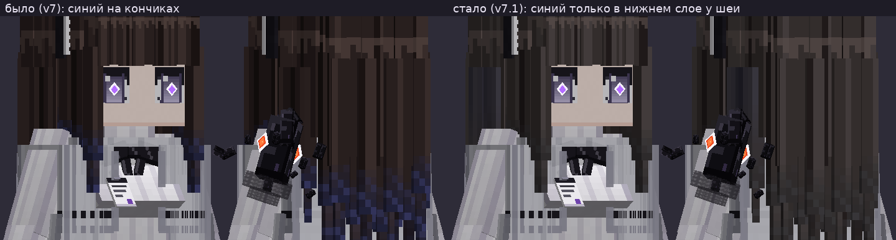
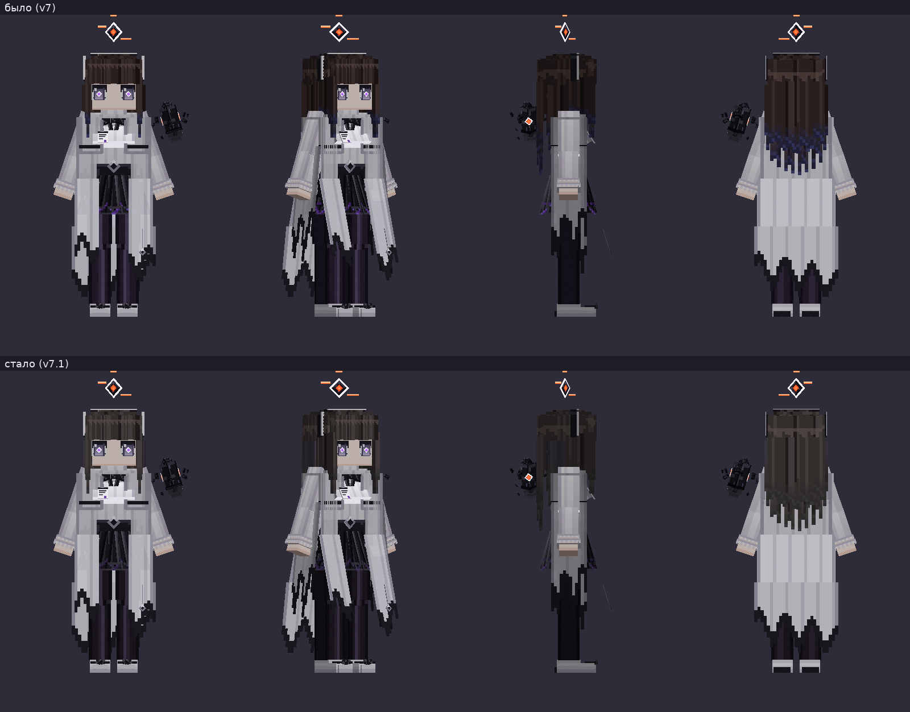
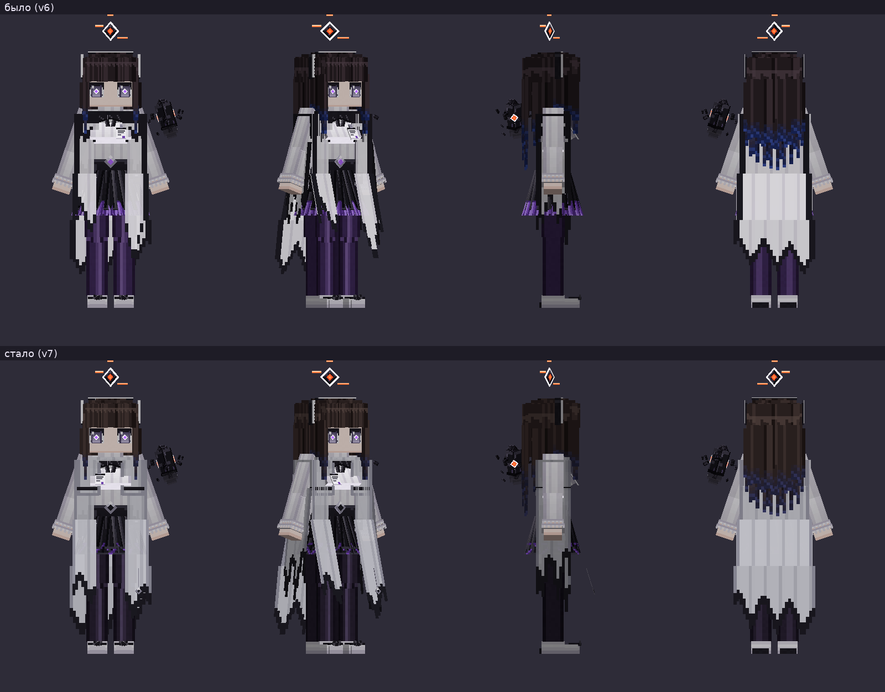
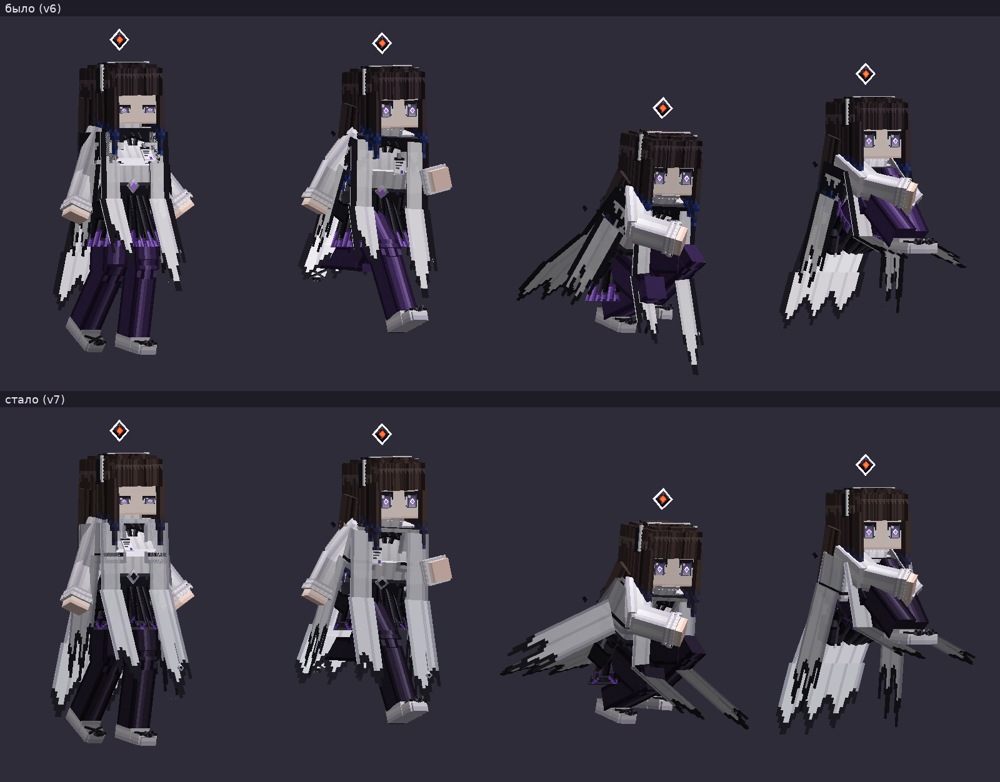
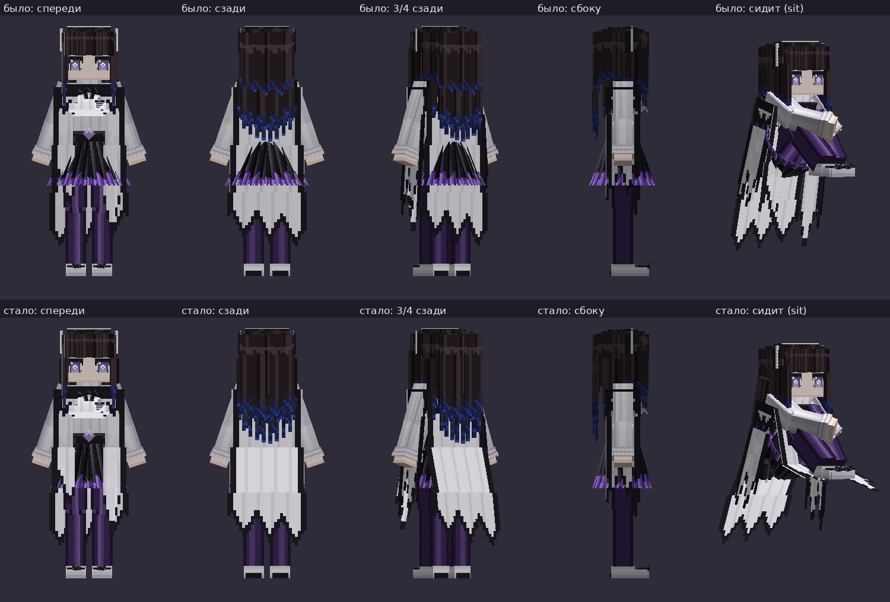
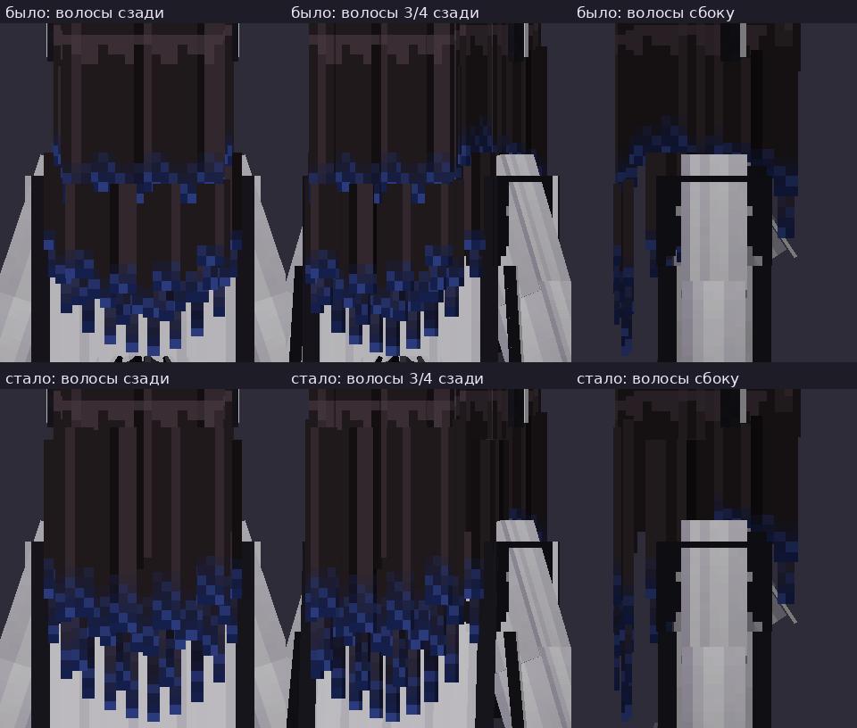
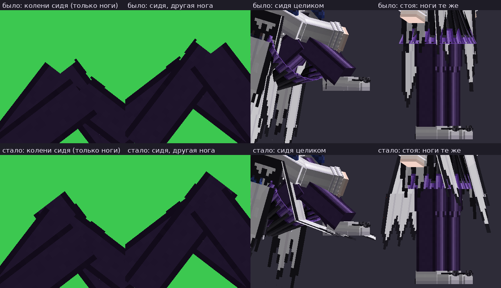

# Модели игроков Yes Steve Model (YSM 2.6.5)

Мод `yes-steve-model` (сторона `both`) заменяет модель игрока. Модели лежат на сервере в
`config/yes_steve_model/custom/`; сервер сам раздаёт их всем клиентам (в зашифрованном виде),
а в одиночной игре их читает встроенный сервер из той же папки клиента. После правки моделей на сервере —
`/ysm model reload` (оператор).

macOS: YSM на Mac не работает. В облаке (виртуальная машина) клиент YSM тоже не запускается
(`docs/compat.md` К7), поэтому модели в игре проверяют игроки на своих ПК — чек-лист внизу.

## Как выбрать модель
1. В *Настройки → Управление* найти раздел **Yes Steve Model** и назначить клавиши — в сборке клавиши модов
   по умолчанию не назначены (если клавиш много — поиск по «Yes Steve» в Controlling). Нужны:
   **меню моделей** и **колесо анимаций** (позы, настройки модели).
2. Меню моделей → слева разделы-«пакеты»: *Arknights*, *Arknights: Endfield*, *Punishing: Gray Raven*, *Azur Lane*, *Azur Lane (FREE-YSM-AUTHOR)* (124 модели, часть может быть 18+ — см. ниже),
   встроенные (Default, Wine Fox) и **Priestess** (наша). Выбрать модель и, если есть, вариант текстуры.
3. Свою модель видно в виде от третьего лица (F5); друзья видят её на сервере сразу.
4. Колесо анимаций: позы и кнопка настроек модели (у Priestess — пункт «Настройки»).
   Позу «закрепить», чтобы ходьба её не прерывала, — замок в колесе (Alt+L).

## Как раздаются модели
- **Готовые модели** (84 файла, ~48 МБ) в наш репозиторий не копируются: в `pack/config/yes_steve_model/custom/<пакет>/`
  лежат packwiz-метафайлы `*.pw.toml` со ссылкой на файл в репозитории
  [Elaina69/Yes-Steve-Model-Repo](https://github.com/Elaina69/Yes-Steve-Model-Repo) (закреплён коммит `1749b464`,
  хэш sha256 проверяется). Клиенты получают файлы через packwiz-installer или `.mrpack` (ссылки на raw.githubusercontent.com),
  сервер — `scripts/fetch-config-files.py` (его вызывают `test-server.sh` и `export-pack.sh`).
  Обновить/перегенерировать: `scripts/ysm-models.py <клон Elaina69/Yes-Steve-Model-Repo>` (инструкция в скрипте), затем `packwiz refresh`.
- **Priestess** — папка-модель в `pack/config/yes_steve_model/custom/priestess/` (~1 МБ), собирается
  `mods-src/ysm-priestess/build.py` (см. ниже).

## Готовые модели (Elaina69/Yes-Steve-Model-Repo)
Все модели из папок `_Arknights`, `_ArknightsEndfield`, `_PunishingGrayRaven`, `_AzurLane` репозитория Elaina69 (сборщик модельного
архива; авторы моделей — ниже, имена как в файлах). Решение владельца: лицензии моделей (в т.ч. NC/ND/ARR) нас не
ограничивают — сборка некоммерческая (CLAUDE.md «Назначение и лицензии»), авторство указываем.

Проверка на сервере (`scripts/test-server.sh`, 2026-10-17): сервер доходит до `Done`, YSM прочитал **65 из 66** моделей
(+ 27 встроенных) — счёт по серверному кэшу `config/yes_steve_model/cache/server` (для файлов `.ysm`/`.zip`; модели-папки в него не попадают), сама YSM в лог по моделям не пишет;
непрочитанная найдена делением набора пополам. Формат `.ysm` новее, чем умеет 2.6.5, в наборе нет (самые новые — формат 26).

Не читается: `AK_Rosmontis_v0.9.ysm` (формат 26) — YSM 2.6.5 не загружает её даже одну (прогон с одним этим файлом: 0 моделей в кэше), в паре с v1.0 грузится только v1.0. **Не раздаём** (`skip` в `scripts/ysm-models.py`); остаются v1.0, v1.1, v1.3 и две старые zip-версии Rosmontis. Итого раздаётся **65** моделей.

**Azur Lane** (`_AzurLane`, добавлено 2026-10-18 по просьбе владельца): 19 файлов, 17,3 МБ — все читаются в YSM 2.6.5
(прогон только с ними: кэш 45 = 26 встроенных + 19; пустой набор — 26). Раздаются все версии, как и у Arknights
(Littorio — четыре варианта, Yamashiro — 2.3.2.1 и 2.4.3, Akashi — обычная и облегчённая). Всего раздаётся **84** модели.

| Пакет | Файл | Имя в модели | Авторы (из файла) | Лицензия (из файла) | Формат |
|---|---|---|---|---|---|
| Arknights | `AK_Chen.ysm` | 陈 | 日月明567 (模型) | All Rights Reserved | .ysm, формат 15 |
| Arknights | ~~`AK_Rosmontis_v0.9.ysm`~~ (не читается, не раздаём) | Rosmontis | 平行Rosmontis (ALL) | CC BY-NC-ND 4.0 | .ysm, формат 26 |
| Arknights | `AK_Rosmontis_v1.0.ysm` | Rosmontis | 平行Rosmontis (ALL) | CC BY-NC-ND 4.0 | .ysm, формат 26 |
| Arknights | `AK_Sora_v1.0_Fllz.ysm` | Sora_Default | Fllz (Model Author) | All Rights Reserved | .ysm, формат 15 |
| Arknights | `Ak_Angelina.ysm` | 安洁莉娜_free | 映白L (作者) | CC BY-NC-SA 4.0 | .ysm, формат 15 |
| Arknights | `Ak_Aurora.ysm` | 极光 | 映白L (作者) | CC BY-NC-SA 4.0 | .ysm, формат 9 |
| Arknights | `Ak_Cannot_Goodenough.ysm` | 坎诺特 · 古德因纳夫 | 布萊德 · 基德 (模型) | CC 4.0 NC-BY-SA | .ysm, формат 15 |
| Arknights | `Ak_Eblana.ysm` | 爱布拉娜 | MicroCraft (动画和物理参考模仿), BradKidd (模型) | CC 4.0 NC-BY-SA | .ysm, формат 15 |
| Arknights | `Ak_Eblana_1.21-fix-2.ysm` | 爱布拉娜 | MicroCraft (动画和物理参考模仿), BradKidd (模型) | CC 4.0 NC-BY-SA | .ysm, формат 15 |
| Arknights | `Ak_Eblana_1.21-fix.ysm` | 爱布拉娜 | MicroCraft (动画和物理参考模仿), BradKidd (模型) | CC 4.0 NC-BY-SA | .ysm, формат 15 |
| Arknights | `Ak_Fiammetta.ysm` | Default | 哥斯拉 (模型), 端木一动不动 (动画), 甜粽子 (动画), 星屑海螺 (动画) | CC 0 | .ysm, формат 9 |
| Arknights | `Ak_Hoolheyak.ysm` |  | — (в файле не указаны; карточка модели в меню YSM) | — | .ysm, старый бинарный v2 |
| Arknights | `Ak_Irene_1.ysm` | 艾丽妮 | 烛火的次元宇宙 (模型), 烛火的次元宇宙 (动画) | CC BY-NC-SA 4.0 | .ysm, формат 15 |
| Arknights | `Ak_Jessica(Defender)_v1.0.ysm` |  | — (в файле не указаны; карточка модели в меню YSM) | — | .ysm, старый бинарный v2 |
| Arknights | `Ak_Kaltsit.ysm` |  | — (в файле не указаны; карточка модели в меню YSM) | — | .ysm, старый бинарный v2 |
| Arknights | `Ak_Kirara.ysm` | 绮良_free | 映白L (作者) | CC BY-NC-SA 4.0 | .ysm, формат 15 |
| Arknights | `Ak_Kirara_v1.01.ysm` | 绮良_free | 映白L (作者) | CC BY-NC-SA 4.0 | .ysm, формат 15 |
| Arknights | `Ak_LaPluma_v1.0.ysm` | 羽毛笔 | 失踪的李元 (模型) | CC BY-NC-SA 4.0 | .ysm, формат 9 |
| Arknights | `Ak_Magallan.ysm` |  | — (в файле не указаны; карточка модели в меню YSM) | — | .ysm, старый бинарный v2 |
| Arknights | `Ak_May.ysm` | 梅 | 烛火的次元宇宙 (模型) | CC BY-NC-SA 4.0 | .ysm, формат 15 |
| Arknights | `Ak_Mudrock(AmbienceSynesthesia)_0.ysm` | 黑曜石_泥岩 | 嗯嗯owo (模型), 嗯嗯owo (动画), 嗯嗯owo (动画), 嗯嗯owo (动画) | CC BY-NC-ND 4.0 | .ysm, формат 9 |
| Arknights | `Ak_Mudrock(AmbienceSynesthesia)_1.ysm` | 黑曜石_泥岩 | 嗯嗯owo (模型), 嗯嗯owo (动画), 嗯嗯owo (动画), 嗯嗯owo (动画) | CC BY-NC-ND 4.0 | .ysm, формат 9 |
| Arknights | `Ak_Mudrock(Coral-Coast)_0.ysm` | 静谧午夜_泥岩 | 嗯嗯owo (模型), 嗯嗯owo (动画), 嗯嗯owo (动画), 嗯嗯owo (动画) | CC BY-NC-ND 4.0 | .ysm, формат 9 |
| Arknights | `Ak_Mudrock(Coral-Coast)_1.ysm` | 静谧午夜_泥岩 | 嗯嗯owo (模型), 嗯嗯owo (动画), 嗯嗯owo (动画), 嗯嗯owo (动画) | CC BY-NC-ND 4.0 | .ysm, формат 9 |
| Arknights | `Ak_Mudrock_0.ysm` | 泥岩_原皮肤 | 嗯嗯owo (模型), 嗯嗯owo (动画), 嗯嗯owo (动画), 嗯嗯owo (动画) | CC BY-NC-ND 4.0 | .ysm, формат 9 |
| Arknights | `Ak_Mudrock_1.1.1.ysm` | 泥岩_砾瓦 | 嗯嗯owo (模型), 嗯嗯owo (动画), 嗯嗯owo (动画), 嗯嗯owo (动画) | CC BY-NC-ND 4.0 | .ysm, формат 9 |
| Arknights | `Ak_Mudrock_1.5.2.ysm` | 泥岩_砾瓦aa | 嗯嗯owo (模型), 嗯嗯owo (动画), 嗯嗯owo (动画), 嗯嗯owo (动画) | CC BY-NC-ND 4.0 | .ysm, формат 15 |
| Arknights | `Ak_Myrtle.ysm` |  | — (в файле не указаны; карточка модели в меню YSM) | — | .ysm, старый бинарный v2 |
| Arknights | `Ak_Nearl(Horse-form).ysm` | 临光 | 烈鸟比百 (人物模型) | CC 0 | .ysm, формат 9 |
| Arknights | `Ak_Nian.ysm` |  | — (в файле не указаны; карточка модели в меню YSM) | — | .ysm, старый бинарный v2 |
| Arknights | `Ak_Pepe.ysm` | 佩佩 | 寒叔 (模型) | CC BY-NC-SA 4.0 | .ysm, формат 4 |
| Arknights | `Ak_Projekt-Red(Coral-Coast)_1.ysm` | 红_轻风 LB01 | 嗯嗯owo (模型), 嗯嗯owo (动画), 嗯嗯owo (材质), 嗯嗯owo (模型) | All Rights Reserved | .ysm, формат 9 |
| Arknights | `Ak_Ptilopsis.ysm` | 白面鸮 - 免费版 | 映白L (作者) | CC BY-NC-SA 4.0 | .ysm, формат 9 |
| Arknights | `Ak_Rosmontis_v1.1.ysm` | 迷迭香 | 平行Rosmontis (迷迭香) | CC 0 | .ysm, формат 9 |
| Arknights | `Ak_Rosmontis_v1.3.ysm` | 迷迭香 | 平行Rosmontis (迷迭香) | CC 0 | .ysm, формат 9 |
| Arknights | `Ak_Saga.ysm` |  | — (в файле не указаны; карточка модели в меню YSM) | — | .ysm, старый бинарный v1 |
| Arknights | `Ak_Shamare(WitchFeast)_v1.0_Fllz.ysm` | Shamare | 哥斯拉 (模型), 端木一动不动 (动画), 甜粽子 (动画), 星屑海螺 (动画), Fllz (Model author) | CC BY | .ysm, формат 15 |
| Arknights | `Ak_Shu.ysm` | 黍 | 烈鸟比百（模型） | All Rights Reserved | .ysm, формат 1 |
| Arknights | `Ak_Sideroca(Coral-Coast)_2.ysm` | 轻风LB03_铸铁 | 嗯嗯owo (模型), 嗯嗯owo (动画), 嗯嗯owo (动画), 嗯嗯owo (动画) | CC BY-NC-ND 4.0 | .ysm, формат 9 |
| Arknights | `Ak_Skadi(Sleepwear).ysm` | 斯卡蒂_free | 映白L (作者) | All Rights Reserved | .ysm, формат 15 |
| Arknights | `Ak_Skadi.ysm` |  | — (в файле не указаны; карточка модели в меню YSM) | — | .ysm, старый бинарный v2 |
| Arknights | `Ak_Soldier.ysm` | 整合运动士兵 | 空气避难所 | All Rights Reserved | .ysm, формат 15 |
| Arknights | `Ak_Specter(Speciallist)_v1.0.ysm` |  | — (в файле не указаны; карточка модели в меню YSM) | — | .ysm, старый бинарный v2 |
| Arknights | `Ak_Suzuran.ysm` | 铃兰 - 免费版 | 映白L | CC BY-NC-SA 4.0 | .ysm, формат 1 |
| Arknights | `Ak_Texas(Epoque).ysm` |  | — (в файле не указаны; карточка модели в меню YSM) | — | .ysm, старый бинарный v2 |
| Arknights | `Ak_Texas(Speciallist)_v1.0.ysm` |  | — (в файле не указаны; карточка модели в меню YSM) | — | .ysm, старый бинарный v2 |
| Arknights | `Ak_Vigna(Coral-Coast).ysm` | 红豆—悠然假日 | 烛火的次元宇宙 (模型), 烛火的次元宇宙 (动画) | CC BY-NC-SA 4.0 | .ysm, формат 15 |
| Arknights | `Ak_Virtuosa.ysm` |  | — (в файле не указаны; карточка модели в меню YSM) | — | .ysm, старый бинарный v2 |
| Arknights | `Ak_Waiifu.ysm` |  | — (в файле не указаны; карточка модели в меню YSM) | — | .ysm, старый бинарный v2 |
| Arknights: Endfield | `Endfield_Rossi_v1.1.ysm` | 终末地 | — (в файле не указаны; карточка модели в меню YSM) | -- | .ysm, формат 26 |
| Punishing: Gray Raven | `PGR_Adolf2.ysm` | Adolf 2.0 | NekuroMC | CC BY-SA 4.0 | .ysm, формат 1 |
| Punishing: Gray Raven | `PGR_Lamia.ysm` |  | — (в файле не указаны; карточка модели в меню YSM) | — | .ysm, старый бинарный v2 |
| Punishing: Gray Raven | `PGR_Lucia_1.4.ysm` |  | — (в файле не указаны; карточка модели в меню YSM) | — | .ysm, старый бинарный v2 |
| Punishing: Gray Raven | `PGR_Lucia_1.ysm` |  | — (в файле не указаны; карточка модели в меню YSM) | — | .ysm, старый бинарный v2 |
| Arknights | `Ak_Bitey.zip` | 阿咬 | 映白L (作者) | CC BY-NC-SA 4.0 | .zip (папка, spec 2) |
| Arknights | `Ak_Chen(Tourist-C).zip` | 陈 | 一个普通的创作者 | CC BY-SA 4.0 | .zip (папка, spec 2) |
| Arknights | `Ak_Eyjafjalla(Medic)_v1.0.zip` | Default | 妖梦 (模型) | CC 0 | .zip (папка, spec 2) |
| Arknights | `Ak_Irene.zip` | 艾丽妮 | 桦 (114514) | CC BY-NC-AS4.0 | .zip (папка, spec 2) |
| Arknights | `Ak_Jessica.zip` |  | — (в файле не указаны; карточка модели в меню YSM) | — | .zip (формат YSM 1.x) |
| Arknights | `Ak_Kaltsit_0.zip` |  | — (в файле не указаны; карточка модели в меню YSM) | — | .zip (формат YSM 1.x) |
| Arknights | `Ak_Lappland.zip` |  | — (в файле не указаны; карточка модели в меню YSM) | — | .zip (формат YSM 1.x) |
| Arknights | `Ak_Penance_0.zip` |  | — (в файле не указаны; карточка модели в меню YSM) | — | .zip (формат YSM 1.x) |
| Arknights | `Ak_Penance_1.zip` |  | — (в файле не указаны; карточка модели в меню YSM) | — | .zip (формат YSM 1.x) |
| Arknights | `Ak_Rosmontis_0.zip` |  | — (в файле не указаны; карточка модели в меню YSM) | — | .zip (формат YSM 1.x) |
| Arknights | `Ak_Rosmontis_1.zip` |  | — (в файле не указаны; карточка модели в меню YSM) | — | .zip (формат YSM 1.x) |
| Arknights | `Ak_Typhon.zip` |  | — (в файле не указаны; карточка модели в меню YSM) | — | .zip (формат YSM 1.x) |
| Azur Lane | `AL_Agir.ysm` |  | — (в файле не указаны; карточка модели в меню YSM) | — | .ysm, старый бинарный v2 |
| Azur Lane | `AL_Akashi(Lightweight).ysm` |  | — (в файле не указаны; карточка модели в меню YSM) | — | .ysm, старый бинарный v2 |
| Azur Lane | `AL_Akashi.ysm` |  | — (в файле не указаны; карточка модели в меню YSM) | — | .ysm, старый бинарный v2 |
| Azur Lane | `AL_Alsace.ysm` | Alsace | NekuroMC | CC BY-NC-SA 4.0 | .ysm, формат 1 |
| Azur Lane | `AL_Amagi(Summer)_v1.0.ysm` |  | — (в файле не указаны; карточка модели в меню YSM) | — | .ysm, старый бинарный v2 |
| Azur Lane | `AL_ChangChun.ysm` | 长春·改 | 伊蕾娜家的咸鱼 & 星屑海螺 | CC BY-NC-ND 4.0 | .ysm, формат 1 |
| Azur Lane | `AL_Helena.ysm` | 海伦娜 | 深海沉光 (模型), 星语 (动作) | All Rights Reserved | .ysm, формат 15 |
| Azur Lane | `AL_Kawakaze.ysm` | Kawakaze | ShiroKaze | All Rights Reserved | .ysm, формат 1 |
| Azur Lane | `AL_Littorio(With_arm)_v1.0.ysm` |  | — (в файле не указаны; карточка модели в меню YSM) | — | .ysm, старый бинарный v2 |
| Azur Lane | `AL_Littorio(With_arm)_v1.1.ysm` |  | — (в файле не указаны; карточка модели в меню YSM) | — | .ysm, формат 9 |
| Azur Lane | `AL_Littorio.ysm` |  | — (в файле не указаны; карточка модели в меню YSM) | — | .ysm, старый бинарный v2 |
| Azur Lane | `AL_Littorio_v1.1.ysm` |  | — (в файле не указаны; карточка модели в меню YSM) | — | .ysm, формат 9 |
| Azur Lane | `AL_Nagato.ysm` |  | — (в файле не указаны; карточка модели в меню YSM) | — | .ysm, старый бинарный v2 |
| Azur Lane | `AL_Nautilus.ysm` |  | — (в файле не указаны; карточка модели в меню YSM) | — | .ysm, старый бинарный v2 |
| Azur Lane | `AL_Ping-Hai_v1.0.ysm` | 平海 | 星语TAT、雾雨波波沙 | CC 0 | .ysm, формат 1 |
| Azur Lane | `AL_Tashkent_1.5.ysm` | 塔什干 | 隐居中的Fe2O3 (全局), 塔什干 (陪伴) | CC BY-NC-SA 4.0 | .ysm, формат 15 |
| Azur Lane | `AL_Yamashiro_2.3.2.1.ysm` | 山城 | 星语 (动作), 雾雨波波沙 (模型), 秋枫落叶 (技术支持), Cosine_line (测试) | CC 0 | .ysm, формат 15 |
| Azur Lane | `AL_Yamashiro_2.4.3.ysm` | 山城 | 星语 (动作), 雾雨波波沙 (模型), 秋枫落叶 (技术支持), Cosine_line (测试) | CC 0 | .ysm, формат 15 |
| Azur Lane | `AL_Yukikaze_2.4.1.ysm` | 雪风 | 星语 (动作), Nss. (模型) | All Rights Reserved | .ysm, формат 15 |
## Azur Lane из сборника FREE-YSM-AUTHOR (пакет «Azur Lane (FREE-YSM-AUTHOR)», поток 37, 2026-10-18, решение владельца В38)

> **Предупреждение 18+.** Часть моделей этого пакета может быть 18+ (так пишет автор сборника): в имени файла есть метки
> `Nsfw`/`NSFW` и `18plus` (так помечены файлы с «非公开» — «закрытая версия»; рядом у тех же авторов есть «全年龄» — «для всех возрастов», это `allages`, поэтому «закрытые», вероятно, 18+).
> Метка в имени файла есть не у всех — полной уверенности, что остальные «чистые», нет. **Как убрать лишнее:** удалить соответствующий
> метафайл `pack/config/yes_steve_model/custom/azur_lane_ysmauthor/<файл>.pw.toml` (в репозитории) — или у игрока файл
> `config/yes_steve_model/custom/azur_lane_ysmauthor/<файл>` — и **на сервере тоже** (иначе модель останется в меню у всех), затем `/ysm model reload`.
> Весь пакет целиком — удалить папку `azur_lane_ysmauthor`. Картинок моделей в репозитории нет.

Источник: [nekohalawrence/FREE-YSM-AUTHOR](https://github.com/nekohalawrence/FREE-YSM-AUTHOR), ветка `main` (закреплён коммит `17db8b6b`);
в ветке по умолчанию лежит только README. Сборник организован по **авторам** (папка `NNNN-<автор>/`), модели Azur Lane — подпапки `AL_*`
(плюс «圣路易斯»; `BA_*` — это Blue Archive, не берём). Автор сборника сам пишет, что большая часть моделей в нём «повреждена» (только индекс авторов) —
действительно, 12 файлов наш YSM 2.6.5 не читает.

Как собрано (`scripts/ysm-models-author.py`, исключения — `scripts/ysm-models-author-skip.txt`, индекс — `scripts/pack-index-refresh.py`):
- в сборнике 66 AL-папок, 148 файлов (142 `.ysm` + 6 `.zip`), 617 МБ; без дублей с Elaina69 (тот же sha256, 8 файлов) и внутренних дублей — **136 файлов, 590 МБ**;
  из них YSM 2.6.5 не читает 12 → раздаётся **124 файлов, 501 МБ**. Владелец выбрал «всё уникальное» (В38), версии не отсеивались.
- в папке модели лежат под **ASCII-именами** `<номер автора>_<латиница из имени>[_<6 hex sha256>]` (в сборнике одно и то же имя `AL_柴郡_Cheshire.ysm` у трёх авторов, а YSM берёт id модели
  из имени файла); исходный путь в сборнике — в колонке «Исходный файл». Имя в меню — из метаданных самой модели.
- не читаются (проверено по одному файлу в минимальном сервере с одной лишь YSM: кэш моделей не растёт): `0045_AL_Fusou.ysm`, `0045_AL_LC_AL_v2.4.1.ysm`, `0045_AL_Nagato_v2.4.2.ysm`, `0045_AL_Nagato_v2.4.3.ysm`, `0045_AL_Nagato_v2.5.0.ysm`, `0045_AL_Yamashiro_v2.4.3_1.ysm`, `0045_AL_Yamashiro_v2.4.4.zip`, `0045_AL_Yamashiro_v2.5.4.ysm`, `0045_AL_Yamashiro_v2.5.6.1.ysm`, `0045_AL_Yamashiro_v2.5.6.zip`, `0055_AL_Kms-gir_v3.2.ysm`, `0105_AL_KanCollect-Yukikaze_v2.4.1_1.ysm`.
- кэш YSM: пустой набор 26 → с Elaina69 111 → **233** (+122 на 124 файлов: два файла делят с другими один внутренний id/хэш модели и в кэше сливаются).
- **«Бесплатная» ли модель.** В метаданных многих файлов `free = false` (автор отмечает модель платной/для спонсоров, у «艺方» в описании — «после покупки модели»). Лицензии — по метаданным;
  решение владельца (CLAUDE.md «Назначение и лицензии»): сборка некоммерческая, лицензии не мешают, авторство сохраняем. Если автор попросит убрать модель — удалить метафайл.

| Файл (в `azur_lane_ysmauthor/`) | Имя в модели | Авторы (из файла) | Лицензия (из файла) | Бесплатная (`free`) | Исходный файл в сборнике (папка автора опущена) | МБ |
|---|---|---|---|---|---|---|
| `0005_Unknown_Rei-Ayanami.ysm` | | — | — | ? | `AL_Ayanami_rei_绫波_LD/Unknown_Rei-Ayanami.ysm` | 0.2 |
| `0005_Unknown_Rei-Ayanami.zip` | | — | — | ? | `AL_Ayanami_rei_绫波_LD/Unknown_Rei-Ayanami.zip` | 0.2 |
| `0005_AL_Cheshire.ysm` | 柴郡 HMS Cheshire丨【绚烂夜梦】 | omo仙贝2号！https://space.bilibili.com/1959304255?spm_id_from=333.1296.0.0 | CC BY-NC-SA 4.0 | да | `AL_Cheshire_柴郡_LC/AL_柴郡_Cheshire.ysm` | 0.2 |
| `0005_AL_Cheshire.zip` | | — | — | ? | `AL_Cheshire_柴郡_LC/AL_柴郡_Cheshire.zip` | 0.2 |
| `0005_AL_Ijn-Musashi-Bunngyirl.ysm` | 大和级战列舰二番舰 武藏 （鳄）「堇色兔的狙击游戏」 | — | All rights reserved | да | `AL_Ijn-Musashi_bunngyirl_武藏_兔女郎_LB/AL_武藏_兔女郎_Ijn-Musashi-Bunngyirl.ysm` | 0.2 |
| `0005_AL_Mogador.ysm` | 莫加多尔丨静谧一隅的燥热 | omo仙贝2号！https://space.bilibili.com/1959304255?spm_id_from=333.1296.0.0 | CC BY-NC-SA 4.0 | да | `AL_Mogador_莫加多尔_LC/AL_莫加多尔_Mogador.ysm` | 0.1 |
| `0005_AL_Mogador.zip` | | — | — | ? | `AL_Mogador_莫加多尔_LC/AL_莫加多尔_Mogador.zip` | 0.2 |
| `0014_AL_AL_v1.1.ysm` | 山风_无保时 | 作者: 哈雷汰多 | CC 0 | да | `AL_山风/AL_山风_v1.1.ysm` | 0.5 |
| `0014_AL_AL_v1.1_1.ysm` | 山风 | 作者: 哈雷汰多 | CC 0 | да | `AL_山风/AL_山风_v1.1_1.ysm` | 5.3 |
| `0015_AL_Prinz-Adalbert.ysm` | 阿德莉娅亲王 | — | CC BY-NC-SA 4.0 | да | `AL_Prinz-Adalbert_阿达尔伯特亲王_LA/AL_阿达尔伯特亲王_Prinz-Adalbert.ysm` | 0.4 |
| `0015_AL_Prinz-Adalbert_1.ysm` | 阿达尔伯特亲王Prinz Adalbert | — | CC BY-NC-SA 4.0 | да | `AL_Prinz-Adalbert_阿达尔伯特亲王_LA/AL_阿达尔伯特亲王_Prinz-Adalbert_1.ysm` | 0.4 |
| `0020_AL_Laffey-Bunnygirl.ysm` | 拉菲2兔女郎 | — | CC BY-NC-SA 4.0 | **нет** | `AL_Laffey_bunnygirl_拉菲_兔女郎_LA/AL_拉菲_兔女郎_Laffey-Bunnygirl.ysm` | 4.5 |
| `0020_AL_Laffey-Bunnygirl_1.ysm` | 拉菲2兔女郎 | — | CC BY-NC-SA 4.0 | **нет** | `AL_Laffey_bunnygirl_拉菲_兔女郎_LA/AL_拉菲_兔女郎_Laffey-Bunnygirl_1.ysm` | 4.4 |
| `0020_AL_Laffey-Bunnygirl_v1.1.ysm` | 拉菲2兔女郎 | — | CC BY-NC-SA 4.0 | **нет** | `AL_Laffey_bunnygirl_拉菲_兔女郎_LA/AL_拉菲_兔女郎_Laffey-Bunnygirl_v1.1.ysm` | 4.5 |
| `0020_AL_Laffey-Bunnygirl_v1.2.ysm` | 拉菲2兔女郎 | — | CC BY-NC-SA 4.0 | **нет** | `AL_Laffey_bunnygirl_拉菲_兔女郎_LA/AL_拉菲_兔女郎_Laffey-Bunnygirl_v1.2.ysm` | 5.0 |
| `0020_AL_Laffey-Bunnygirl_v1.5.ysm` | 拉菲2兔女郎 | — | CC BY-NC-SA 4.0 | **нет** | `AL_Laffey_bunnygirl_拉菲_兔女郎_LA/AL_拉菲_兔女郎_Laffey-Bunnygirl_v1.5.ysm` | 5.3 |
| `0020_AL_LeMalin_v1.1.ysm` | 恶毒「懒懒的白兔」 | — | CC BY-ND-SA 4.0 | **нет** | `AL_Lemalin_恶毒_懒懒的白兔/AL_恶毒_懒懒的白兔_LeMalin_v1.1.ysm` | 1.1 |
| `0045_AL_Fusou_v2.4.9.ysm` | 扶桑SFW | — | All Rights Reserved | да | `AL_Fusou_扶桑_LA/AL_扶桑_Fusou_v2.4.9.ysm` | 7.5 |
| `0045_AL_Fusou_v2.4.9_1.ysm` | 扶桑 | — | All Rights Reserved | да | `AL_Fusou_扶桑_LA/AL_扶桑_Fusou_v2.4.9_1.ysm` | 4.7 |
| `0045_AL_Fusou_v2.5.0.ysm` | 扶桑 | — | All Rights Reserved | да | `AL_Fusou_扶桑_LA/AL_扶桑_Fusou_v2.5.0.ysm` | 5.0 |
| `0045_AL_Fusou_v2.5.2.ysm` | 扶桑SFW | — | All Rights Reserved | да | `AL_Fusou_扶桑_LA/AL_扶桑_Fusou_v2.5.2.ysm` | 5.0 |
| `0045_AL_Fusou_v2.5.2_1.ysm` | 扶桑 | — | All Rights Reserved | да | `AL_Fusou_扶桑_LA/AL_扶桑_Fusou_v2.5.2_1.ysm` | 5.5 |
| `0045_AL_Fusou_v2.5.4.ysm` | 扶桑SFW | — | All Rights Reserved | да | `AL_Fusou_扶桑_LA/AL_扶桑_Fusou_v2.5.4.ysm` | 5.0 |
| `0045_AL_Fusou_v2.5.5.ysm` | 扶桑 | — | All Rights Reserved | да | `AL_Fusou_扶桑_LA/AL_扶桑_Fusou_v2.5.5.ysm` | 5.5 |
| `0045_AL_Fusou_v2.5.6.ysm` | 扶桑SFW | — | All Rights Reserved | да | `AL_Fusou_扶桑_LA/AL_扶桑_Fusou_v2.5.6.ysm` | 5.5 |
| `0045_AL_Nagato_v2.4.2_1.ysm` | 长门 | — | All Rights Reserved | да | `AL_Nagato_长门_LA/AL_长门_Nagato_v2.4.2_1.ysm` | 5.7 |
| `0045_AL_Nagato_v2.4.3_1.ysm` | 长门 | — | All Rights Reserved | да | `AL_Nagato_长门_LA/AL_长门_Nagato_v2.4.3_1.ysm` | 5.7 |
| `0045_AL_Yamashiro_v2.3.2.1.ysm` | 山城 | — | All Rights Reserved | да | `AL_Yamashiro_山城_LA/AL_山城_Yamashiro_v2.3.2.1.ysm` | 5.4 |
| `0045_AL_Yamashiro_v2.4.4.ysm` | 山城 | — | All Rights Reserved | да | `AL_Yamashiro_山城_LA/AL_山城_Yamashiro_v2.4.4.ysm` | 4.9 |
| `0045_AL_Yamashiro_v2.4.4_1.ysm` | 山城 | — | All Rights Reserved | да | `AL_Yamashiro_山城_LA/AL_山城_Yamashiro_v2.4.4_1.ysm` | 5.6 |
| `0045_AL_Yamashiro_v2.5.5.ysm` | 山城SFW | — | All Rights Reserved | да | `AL_Yamashiro_山城_LA/AL_山城_Yamashiro_v2.5.5.ysm` | 6.3 |
| `0045_AL_Yamashiro_v2.5.6.ysm` | 山城SFW | — | All Rights Reserved | да | `AL_Yamashiro_山城_LA/AL_山城_Yamashiro_v2.5.6.ysm` | 6.8 |
| `0045_AL_Yamashiro_v2.5.7.ysm` | 山城 | — | All Rights Reserved | да | `AL_Yamashiro_山城_LA/AL_山城_Yamashiro_v2.5.7.ysm` | 8.5 |
| `0045_AL_LC_AL_v2.2.2.7.ysm` | 宁海 | — | CC 0 | да | `AL_宁海_LC/AL_宁海_v2.2.2.7.ysm` | 4.3 |
| `0045_AL_LC_AL_v2.3.2.1.ysm` | 宁海 | — | All Rights Reserved | да | `AL_宁海_LC/AL_宁海_v2.3.2.1.ysm` | 4.7 |
| `0045_AL_LC_AL_v2.4.2.ysm` | 宁海 | — | All Rights Reserved | да | `AL_宁海_LC/AL_宁海_v2.4.2.ysm` | 4.7 |
| `0045_AL_LC_AL_v2.2.2.10.ysm` | 平海 | — | CC 0 | да | `AL_平海_LC/AL_平海_v2.2.2.10.ysm` | 4.3 |
| `0045_AL_LC_AL_v2.2.3.ysm` | 平海 | — | CC 0 | да | `AL_平海_LC/AL_平海_v2.2.3.ysm` | 3.2 |
| `0045_AL_LC_AL_v2.3.2.1_8d35bb.ysm` | 平海 | — | All Rights Reserved | да | `AL_平海_LC/AL_平海_v2.3.2.1.ysm` | 2.8 |
| `0045_AL_LC_AL_v2.4.1_18ecbc.ysm` | 平海 | — | All Rights Reserved | да | `AL_平海_LC/AL_平海_v2.4.1.ysm` | 1.9 |
| `0045_AL_LC_AL_v2.4.2_ed560c.ysm` | 平海 | — | All Rights Reserved | да | `AL_平海_LC/AL_平海_v2.4.2.ysm` | 2.8 |
| `0055_AL_Alsace_v1.2.7.ysm` | 碧蓝航线——阿尔萨斯 | — | CC BY-NC-SA 4.0 | **нет** | `AL_Alsace_阿尔萨斯_LB/AL_阿尔萨斯_Alsace_v1.2.7.ysm` | 4.2 |
| `0055_AL_An-Shan.ysm` | 鞍山·改 | 伊蕾娜家的咸鱼 & 星屑海螺 | CC BY-NC-SA 4.0 | **нет** | `AL_An‑shan_鞍山_LB/AL_鞍山_An-Shan.ysm` | 0.3 |
| `0055_AL_Kancollect-Yukikaze_1.ysm` | 碧蓝航线——雪风Nanoda | — | CC BY-NC-SA 4.0 | **нет** | `AL_Kancollect‑yukikaze_雪风_LA/AL_雪风_Kancollect-Yukikaze_1.ysm` | 3.9 |
| `0055_AL_Kancollect-Yukikaze.ysm` | 碧蓝航线——雪风Nanoda | — | CC BY-NC-SA 4.0 | **нет** | `AL_Kancollect‑yukikaze_雪风_LA/AL_雪风_Kancollect-Yukikaze_快修版.ysm` | 3.9 |
| `0055_AL_Kearsarge_v1.13.ysm` | 碧蓝航线——奇尔沙治 | — | CC BY-NC-SA 4.0 | **нет** | `AL_Kearsarge_奇尔沙治_LA/AL_奇尔沙治_Kearsarge_v1.13.ysm` | 4.2 |
| `0055_AL_Kms-gir_v3.5.1.ysm` | 碧蓝航线-埃吉尔 | — | CC BY-NC-SA 4.0 | **нет** | `AL_Kms‑ägir_埃吉尔_LA/AL_埃吉尔_Kms-ägir_v3.5.1.ysm` | 1.7 |
| `0055_AL_Laffey_v1.1.ysm` | 拉菲2 | — | CC BY-ND-SA 4.0 | **нет** | `AL_Laffey_拉菲_LA/AL_拉菲_Laffey_v1.1.ysm` | 1.3 |
| `0055_AL_Laffey_v1.2.ysm` | 拉菲2 | — | CC BY-ND-SA 4.0 | **нет** | `AL_Laffey_拉菲_LA/AL_拉菲_Laffey_v1.2.ysm` | 1.3 |
| `0055_AL_Sirius_v1.1.ysm` | 天狼星 | — | All Rights Reserved | **нет** | `AL_Sirius_天狼星_LA/AL_天狼星_Sirius_v1.1.ysm` | 3.8 |
| `0058_AL_Ch_ang_Feng_v1.ysm` | 昔涟 25.12.17 | — | All Rights Reserved | **нет** | `AL_Ch'ang-Feng_长风_LA/AL_长风_Ch'ang Feng_v1.ysm` | 0.8 |
| `0058_AL_Ch_ang_Feng_v2.ysm` | 长风 25.11.22 | — | All Rights Reserved | **нет** | `AL_Ch'ang-Feng_长风_LA/AL_长风_Ch'ang Feng_v2.ysm` | 0.9 |
| `0058_AL_Implacable-1_v1.ysm` | 怨仇·办公室的“意外” | — | All Rights Reserved | **нет** | `AL_Implacable_1_怨仇/AL_怨仇级航空母舰_Implacable-1_v1.ysm` | 4.6 |
| `0058_AL_Implacable-1_v2.ysm` | 怨仇·办公室的“意外” | — | All Rights Reserved | **нет** | `AL_Implacable_1_怨仇/AL_怨仇级航空母舰_Implacable-1_v2.ysm` | 4.6 |
| `0058_AL_Implacable.ysm` | 怨仇级航空母舰 | — | All Rights Reserved | **нет** | `AL_Implacable_怨仇/AL_怨仇级航空母舰_Implacable.ysm` | 4.7 |
| `0058_AL_Implacable_1.ysm` | 怨仇级航空母舰 | — | All Rights Reserved | **нет** | `AL_Implacable_怨仇/AL_怨仇级航空母舰_Implacable_1.ysm` | 4.7 |
| `0058_AL_Kawakaze.ysm` | 江风 | — | All Rights Reserved | **нет** | `AL_Kawakaze_江风_LB/AL_江风_Kawakaze.ysm` | 8.1 |
| `0058_AL_Prinz-Rupprecht.ysm` | 鲁普雷希特亲王 | — | CC BY-NC-SA 4.0 | **нет** | `AL_Prinz‑rupprecht_鲁普雷希特亲王_LB/AL_鲁普雷希特亲王_Prinz-Rupprecht.ysm` | 4.3 |
| `0058_AL_Vampire.ysm` | 吸血鬼 25.10.26 | — | All Rights Reserved | **нет** | `AL_Vampire_吸血鬼_LB/AL_吸血鬼_Vampire.ysm` | 7.4 |
| `0083_AL_Fusou.ysm` | 扶桑 | — | CC BY | да | `AL_扶桑_Fusou/AL_扶桑_Fusou.ysm` | 0.2 |
| `0094_AL_Shinano.ysm` | | — | — | ? | `AL_信浓_Shinano_LB/AL_信浓_Shinano.ysm` | 0.2 |
| `0094_AL_Shinano_1.ysm` | | — | — | ? | `AL_信浓_Shinano_LB/AL_信浓_Shinano_1.ysm` | 0.2 |
| `0094_AL_Shinano_2.ysm` | 信浓 | 模型: 墨染逝羽 | All Rights Reserved | **нет** | `AL_信浓_Shinano_LB/AL_信浓_Shinano_2.ysm` | 0.4 |
| `0094_AL_Shinano_3.ysm` | 信浓 | 模型: 墨染逝羽 | All Rights Reserved | **нет** | `AL_信浓_Shinano_LB/AL_信浓_Shinano_3.ysm` | 0.4 |
| `0095_AL_Ch_ang_Feng_v1.0.ysm` | 长风 | — | CC BY-NC SA | **нет** | `AL_Ch'ang Feng_长风_LA/AL_长风_Ch'ang Feng_v1.0.ysm` | 1.2 |
| `0095_AL_Nsfw.ysm` 18+ | 莉莉姆 | 鸡姬(raw_chicken) | CC BY-NC_SA | **нет** | `AL_莉莉姆_Nsfw_LA/AL_莉莉姆_Nsfw.ysm` | 0.2 |
| `0095_AL_Nsfw.zip` 18+ | | — | — | ? | `AL_莉莉姆_Nsfw_LA/AL_莉莉姆_Nsfw.zip` | 0.2 |
| `0101_AL_Ii-Lexington-Ii.ysm` | 列克星敦 | — | CC BY-NC-SA 4.0 | **нет** | `AL_列克星敦_Ii-Lexington-Ii/AL_列克星敦_Ii-Lexington-Ii.ysm` | 0.2 |
| `0102_AL_Admiral-Nakhimov.ysm` | 碧蓝航线-纳希莫夫海军上将 | Dreamer 如有定制需求请联系作者qq:1776296661 | All Rights Reserved | **нет** | `AL_Admiral-Nakhimov_纳希莫夫海军上将_LB/AL_纳希莫夫海军上将_Admiral-Nakhimov.ysm` | 0.2 |
| `0102_AL_Cheshire_v2.0.ysm` | 柴郡-「绚烂夜梦」 | — | All Rights Reserved | 保留所有权利，其不得被自由复制 | да | `AL_Cheshire_柴郡_LB/AL_柴郡_Cheshire_v2.0.ysm` | 0.9 |
| `0102_AL_HDN-Purple-Heart.ysm` | 涅普缇努-绀紫之心 | — | All Right Rrserved | да | `AL_Hdn-Purple-Heart_绀紫之心_LA/AL_绀紫之心_HDN-Purple-Heart.ysm` | 1.0 |
| `0102_AL_Hindenburg.ysm` | 兴登堡 (希尔德加德)-女仆兔女郎 | — | All Right Rrserved | да | `AL_Hindenburg_兴登堡_兔女郎_LB/AL_兴登堡_兔女郎_Hindenburg.ysm` | 0.7 |
| `0102_AL_Implacable_v1_1.ysm` | 碧蓝航线-怨仇 | Dreamer & 如有生物模型定制需求请联系作者qq:1776296661 | All Rights Reserved | **нет** | `AL_Implacable_怨仇_LB/AL_怨仇级航空母舰_Implacable_v1_1.ysm` | 0.3 |
| `0102_AL_New-Jersey.ysm` | 新泽西(花园)-女仆兔女郎 | — | All Right Rrserved | да | `AL_New-Jersey_新泽西_兔女郎_LB/AL_新泽西_兔女郎_New-Jersey.ysm` | 0.7 |
| `0102_AL_Owari.ysm` | 碧蓝航线-尾张（鳂） | Dreamer & 如有生物模型定制需求请联系作者qq:1776296661 | All Rights Reserved | **нет** | `AL_Owari_尾张_愿望为爱_LB/AL_尾张_愿望为爱_Owari.ysm` | 0.4 |
| `0102_AL_Taihou.ysm` | 碧蓝航线-大凤（鹩） | — | All Right Rrserved | да | `AL_Taihou_大凤_LB/AL_大凤_Taihou.ysm` | 0.7 |
| `0103_AL_Amagi-Summer.ysm` | 天城(空母) #24.9.9 | — | All Rights Reserved | да | `AL_Amagi_summer_天城_LA/AL_天城_Amagi-Summer.ysm` | 0.9 |
| `0103_AL_Amagi-Summer_ce8f71.ysm` | 天城(泳装) #24.10.2 | — | All Rights Reserved | да | `AL_Amagi_summer_天城_泳装_LA/AL_天城_泳装_Amagi-Summer.ysm` | 0.4 |
| `0103_AL_Amagi-Summer_1.ysm` | 天城(泳装) #24.10.2 | — | All Rights Reserved | да | `AL_Amagi_summer_天城_泳装_LA/AL_天城_泳装_Amagi-Summer_1.ysm` | 0.4 |
| `0103_AL_II-Lexington-II.ysm` | 列克星敦II | — | All Rights Reserved | да | `AL_Ii-Lexington-Ii_列克星敦_LA/AL_列克星敦_II-Lexington-II.ysm` | 1.1 |
| `0103_AL_Ijn-Musashi-Bunngyirl.ysm` | 武藏 #24.6.29 | — | All Rights Reserved | **нет** | `AL_Ijn-Musashi_bunngyirl_武藏_LA/AL_武藏_Ijn-Musashi-Bunngyirl.ysm` | 0.8 |
| `0103_AL_Ijn-Musashi-Bunngyirl_v1.1.ysm` | 武藏 #24.6.29 | — | All Rights Reserved | **нет** | `AL_Ijn-Musashi_bunngyirl_武藏_LA/AL_武藏_Ijn-Musashi-Bunngyirl_v1.1.ysm` | 1.0 |
| `0103_USS_New_Jersy.ysm` | 新泽西 | — | CC BY-NC-Sa 4.0 | да | `AL_New-Jersey_新泽西_uss/新泽西_USS_New_Jersy.ysm` | 1.1 |
| `0103_AL_Prinz-Eugen_LA.ysm` | 欧根亲王 | — | CC BY-NC-Sa 4.0 | да | `AL_Prinz-Eugen_欧根亲王_LA/欧根亲王.ysm` | 1.6 |
| `0103_AL_Prinz-Eugen_LA_AL.ysm` | 欧根亲王「微醺与试探的距离」 | — | All Rights Reserved | да | `AL_Prinz-Eugen_欧根亲王_微醺与试探的距离_LA/AL_欧根亲王「微醺与试探的距离」.ysm` | 1.2 |
| `0103_AL_TAC_50.ysm` | TAC-50 #24.10.16 | — | All Rights Reserved | да | `AL_TAC_LA/AL_TAC_50.ysm` | 0.5 |
| `0103_AL_Taihou_v2.2.ysm` | 大凤 完整版 #25.5.10 | — | All Rights Reserved | да | `AL_Taihou_大凤_LA/AL_大凤_Taihou_v2.2.ysm` | 1.4 |
| `0103_AL_Taihou_v2.4.ysm` | 大凤 完整版 | — | All Rights Reserved | да | `AL_Taihou_大凤_LA/AL_大凤_Taihou_v2.4.ysm` | 1.7 |
| `0103_AL_YorktownII_II_LA_AL_II.ysm` | 约克城II #24.12.12 | — | All Rights Reserved | да | `AL_Yorktown‑II_约克城II_LA/AL_约克城_II.ysm` | 1.1 |
| `0103_AL_LA_AL.ysm` | 应瑞「松戏梅」 #25.2.5 | — | All Rights Reserved | **нет** | `AL_应瑞_LA/AL_应瑞.ysm` | 2.4 |
| `0103_AL_LA_AL_c6ba8c.ysm` | 白凤 #25.9.12 | — | All Rights Reserved | да | `AL_白凤_LA/AL_白凤.ysm` | 1.4 |
| `0103_AL_LA_AL_v2.0.ysm` | 能代 #24.10.10 | — | All Rights Reserved | **нет** | `AL_能代_LA/AL_能代_v2.0.ysm` | 2.8 |
| `0105_AL_Ayanami_v2.6.1_2.ysm` | 绫波 | — | All Rights Reserved | да | `AL_Ayanami_绫波_LA/AL_绫波_Ayanami_v2.6.1_2.ysm` | 14.1 |
| `0105_AL_Ayanami_v2.6.1_allages.ysm` | 绫波 | — | All Rights Reserved | да | `AL_Ayanami_绫波_LA/AL_绫波_Ayanami_全年龄_v2.6.1.ysm` | 14.1 |
| `0105_AL_Ayanami_v2.6.3_allages.ysm` | 绫波 | — | All Rights Reserved | да | `AL_Ayanami_绫波_LA/AL_绫波_Ayanami_全年龄_v2.6.3.ysm` | 14.2 |
| `0105_AL_Ayanami_v2.6.1_18plus.ysm` 18+ | 绫波 | — | All Rights Reserved | **нет** | `AL_Ayanami_绫波_LA/AL_绫波_Ayanami_非公开_v2.6.1.ysm` | 14.1 |
| `0105_AL_Ayanami_LA_2.6.2.ysm` | 绫波 | — | All Rights Reserved | да | `AL_Ayanami_绫波_LA/绫波2.6.2.ysm` | 14.2 |
| `0105_AL_Javelin_v2.6.12.ysm` | 标枪 | — | All Rights Reserved | да | `AL_Javelin_标枪_LA/AL_标枪_Javelin_v2.6.12.ysm` | 13.5 |
| `0105_AL_Javelin_v2.6.2.ysm` | 标枪 | — | All Rights Reserved | да | `AL_Javelin_标枪_LA/AL_标枪_Javelin_v2.6.2.ysm` | 2.7 |
| `0105_AL_Javelin_v2.6.3.ysm` | 标枪 | — | All Rights Reserved | да | `AL_Javelin_标枪_LA/AL_标枪_Javelin_v2.6.3.ysm` | 2.7 |
| `0105_AL_Javelin_v2.6.6.ysm` | 标枪 | — | All Rights Reserved | да | `AL_Javelin_标枪_LA/AL_标枪_Javelin_v2.6.6.ysm` | 12.9 |
| `0105_AL_Javelin_v2.6.8.ysm` | 标枪 | — | All Rights Reserved | да | `AL_Javelin_标枪_LA/AL_标枪_Javelin_v2.6.8.ysm` | 13.5 |
| `0105_AL_Javelin_v2.6.12_allages.ysm` | 标枪 | — | All Rights Reserved | да | `AL_Javelin_标枪_LA/AL_标枪_Javelin_全年龄_v2.6.12.ysm` | 13.5 |
| `0105_AL_Javelin_v2.6.9_allages.ysm` | 标枪 | — | All Rights Reserved | да | `AL_Javelin_标枪_LA/AL_标枪_Javelin_全年龄_v2.6.9.ysm` | 13.5 |
| `0105_AL_Javelin_v2.6.12_18plus.ysm` 18+ | 标枪 | — | All Rights Reserved | **нет** | `AL_Javelin_标枪_LA/AL_标枪_Javelin_非公开_v2.6.12.ysm` | 13.5 |
| `0105_AL_Javelin_v2.6.9_18plus.ysm` 18+ | 标枪 | — | All Rights Reserved | **нет** | `AL_Javelin_标枪_LA/AL_标枪_Javelin_非公开_v2.6.9.ysm` | 13.5 |
| `0105_AL_Javelin_LA_-2.6.8_18plus.ysm` 18+ | 标枪 | — | All Rights Reserved | **нет** | `AL_Javelin_标枪_LA/标枪-非公开版2.6.8.ysm` | 13.5 |
| `0105_AL_KanCollect-Yukikaze_v2.4.2.ysm` | 雪风 | — | All Rights Reserved | да | `AL_Kancollect‑yukikaze_雪风_LA/AL_雪风_KanCollect-Yukikaze_v2.4.2.ysm` | 1.3 |
| `0105_AL_KanCollect-Yukikaze_v2.6.1.ysm` | 雪风 | — | All Rights Reserved | да | `AL_Kancollect‑yukikaze_雪风_LA/AL_雪风_KanCollect-Yukikaze_v2.6.1.ysm` | 7.7 |
| `0105_AL_KanCollect-Yukikaze_v2.6.2.ysm` | 雪风 | — | All Rights Reserved | да | `AL_Kancollect‑yukikaze_雪风_LA/AL_雪风_KanCollect-Yukikaze_v2.6.2.ysm` | 7.7 |
| `0105_AL_Kancollectyukikaze_LA_-2.6.3_18plus.ysm` 18+ | 雪风 | — | All Rights Reserved | **нет** | `AL_Kancollect‑yukikaze_雪风_LA/雪风-非公开2.6.3.ysm` | 7.7 |
| `0105_AL_Kancollectyukikaze_LA_2.6.3.ysm` | 雪风 | — | All Rights Reserved | да | `AL_Kancollect‑yukikaze_雪风_LA/雪风2.6.3.ysm` | 7.7 |
| `0105_AL_Z23_LA_AL_Z23_v2.4.1.ysm` | Z23 | — | All Rights Reserved | да | `AL_Z23_尼米_LA/AL_尼米_Z23_v2.4.1.ysm` | 1.5 |
| `0105_AL_Z23_LA_AL_Z23_v2.6.1.ysm` | Z23 | — | All Rights Reserved | да | `AL_Z23_尼米_LA/AL_尼米_Z23_v2.6.1.ysm` | 10.9 |
| `0105_AL_Z23_LA_AL_Z23_v2.6.1_1.ysm` | Z23 | — | All Rights Reserved | **нет** | `AL_Z23_尼米_LA/AL_尼米_Z23_v2.6.1_1.ysm` | 10.9 |
| `0105_AL_Z23_LA_AL_Z23_v2.6.1_2.ysm` | Z23 | — | All Rights Reserved | да | `AL_Z23_尼米_LA/AL_尼米_Z23_v2.6.1_2.ysm` | 10.9 |
| `0107_AL_KanCollect-Yukikaze_v1.0.ysm` | 雪风 | — | All Rights Reserved | да | `AL_雪风_KanCollect-Yukikaze/AL_雪风_KanCollect-Yukikaze_v1.0.ysm` | 0.7 |
| `0107_AL_KanCollect-Yukikaze_v1.1.ysm` | 雪风 | — | All Rights Reserved | да | `AL_雪风_KanCollect-Yukikaze/AL_雪风_KanCollect-Yukikaze_v1.1.ysm` | 0.7 |
| `0107_AL_KanCollect-Yukikaze_1.2.ysm` | 雪风 | — | All Rights Reserved | да | `AL_雪风_KanCollect-Yukikaze/雪风_1.2.ysm` | 0.7 |
| `0111_AL_LA_AL.ysm` | 碧蓝航线-土佐 | — | All Rights Reserved | **нет** | `AL_士佐_水着_LA/AL_士佐_水着.ysm` | 0.3 |
| `0116_AL_Cheshire.ysm` | 柴郡_绚烂夜梦 | 1111111re | CC BY-NC-SA 4.0 | **нет** | `AL_柴郡_Cheshire_LB/AL_柴郡_Cheshire.ysm` | 0.3 |
| `0160_-_NSFW.ysm` 18+ | | — | — | ? | `圣路易斯/碧蓝航线-圣路易斯 NSFW.ysm` | 0.4 |
| `0160__-.ysm` | | — | — | ? | `圣路易斯/碧蓝航线-圣路易斯.ysm` | 0.3 |
| `0190_AL_Shinano.ysm` | 信浓 幻梦奇术 | 模型制作: 新隆肰懿 | All Rights Reserved | да | `AL_信浓_Shinano_LA/AL_信浓_Shinano.ysm` | 1.2 |

## Priestess (Arknights) — своя модель
Авторство: Minecraft_moded (поток 32, Claude) — геометрия, текстура 256×256, осколок Originium, формы предметов,
глаза, плащ, позы, логика. Скелет (имена и иерархия костей) и базовые анимации — встроенная модель YSM «default»
(CC 0; 哥斯拉 — модель, 端木一动不动, 甜粽子, 星屑海螺 — анимации, 蓝玫瑰 — текстура/модель, 艾雷克亚 — анимации Iron's Spells),
поэтому работают все состояния: стоит, ходьба, бег, присед, плавание, полёт и элитры, сон, езда (лошадь, свинья, лодка),
лестницы, удары, использование и удержание предметов по категориям, анимации Iron's Spells и TACZ, смерть.
Персонаж — Arknights (Hypergryph). Ориентир по качеству — Ak_Shu (зашифрован, только как ориентир).

Внешний вид (по 5 референсам владельца, сверено с официальным игровым спрайтом в v7/v7.1): длинные прямые тёмные серо-коричневые
волосы до груди, сланцево-фиолетовый отлив только в нижнем слое у шеи, ровная чёлка-химэ, боковые пряди; чёрный ободок с белым кружевом;
серо-фиолетовые глаза с фиолетовыми ромбами-зрачками; белый свитер в рубчик с высоким воротом, чёрный бант-лента, манжеты-рюши;
полупрозрачный светло-серый халат до лодыжек: пелерина на плечах почти до локтя с чёрной полосой у края, лацканы, полы до середины
голени с чёрной каймой по подолу, асимметричный подол с клиньями, подвеска-ромб на левой поле; подсумки на поясе (слева маленькие,
справа большая), свисающие ремешки; бейдж на клипсе (правая сторона груди); короткая чёрная плиссированная юбка, по низу —
фиолетовые ремешки крест-накрест; ремень с ромбовой пряжкой; почти чёрные колготки с фиолетовым оттенком; белые туфли с чёрным
бантом и ремешком-крестом; над головой — светящийся красно-белый ромб с глитч-обрывками (решение владельца, в оригинале его нет).

**v7.1 (2026-10-25, сборка 2026.10.25-5)** — цвета по замеру пикселей спрайта `avg_npc_083` (решение владельца В52: «максимально
близко к оригиналу»; поток 65). Волосы оригинала — нейтральный тёмный серо-коричневый (средний #3d3c3c–#494445, тени
#1d1d1d–#2e2626, свет #5b5b5b–#706767, тёплый блик на чёлке #aa8980), кончики того же тона (#49494b); синий — только приглушённый
сланцево-фиолетовый нижний слой у шеи за боковыми прядями (#4e4c5b, тень #353546), не на кончиках. У v7 тон был краснее (#372a29),
а синий насыщеннее (#2b2c4c) и на концах всех прядей. Теперь: основной тон #453d3c, кончики нейтральные, сланцевый отлив — на прядях
за плечами (`hl_side`), к концу пряди сходит на нет. Заодно по тому же замеру: ремешки юбки — тёмный приглушённый фиолетовый
#4a3768 (спрайт #42325c; было яркое #7446b4), колготки темнее #221c26 (спрайт #231c23 / #14141c). Свитер, кожа, халат, туфли
с замером совпадают. Геометрия и анимации не менялись (skirtcheck — как у v7).

**v7 (2026-10-25, сборка 2026.10.25-2)** — сверка с оригиналом Arknights (поток 65, Claude). Референсы (официальные изображения
Hypergryph в репозиторий **не** кладём — только ссылки):
- игровой спрайт NPC `avg_npc_083` (полный рост, основной референс) — дамп ресурсов игры
  [Aceship/Arknight-Images `avg/characters/avg_npc_083.png`](https://github.com/Aceship/Arknight-Images/blob/main/avg/characters/avg_npc_083.png);
- CG сюжета: [`avg_8_9`](https://github.com/Aceship/Arknight-Images/blob/main/avg/images/avg_8_9.png) (лицо, бейдж, бант, лацканы),
  [`avg_ac8mi_Pre`](https://github.com/Aceship/Arknight-Images/blob/main/avg/images/avg_ac8mi_Pre.png) (силуэт сзади),
  `50_i16` эпизода 14 (пелерина с чёрной полосой; дамп [ArknightsAssets](https://github.com/ArknightsAssets/ArknightsAssets),
  `assets/torappu/dynamicassets/avg/images/50_i16.png`);
- страница персонажа: [Arknights Wiki (wiki.gg) — Priestess](https://arknights.wiki.gg/wiki/Priestess).
  Новый спрайт эпизодов 14–15 (`avg_npc_1718_1`) в открытых дампах пока нет — сверка по `avg_npc_083`.

Что изменено в `mods-src/ysm-priestess/build.py` (модель пересобрана):
1. *Халат длиннее:* спинка до лодыжек (низ 1,6 вместо 4,5), полы до середины голени (15,0/17,5 вместо 10,5/15,5), бока 19/21 вместо 14/17.
2. *Цвет халата* — светло-серый (`coat` #dcdce4), отделяется от белого свитера; боковые канты — тонкий серый контур вместо чёрных
   полос 2 px; чёрная кайма подола — сплошной линией (раньше на крутых клиньях рвалась на точки).
3. *Плечи:* чёрная «кокетка» на плечах убрана (у оригинала плечи светлые); пелерина длиннее (до 25,9 — почти локоть), прямой край
   с чёрной полосой (как в CG `50_i16`) вместо клиньев; лацканы по краям полочек.
4. *Колготки* почти чёрные с фиолетовым оттенком (#2a2234) вместо сиреневых (#3e2a58) — больше не читаются как штаны.
5. *Юбка* короче (подол 16,2 вместо 15,0), низ вместо фиолетовой оборки — чёрный с фиолетовыми ремешками крест-накрест.
6. *Волосы* тёмно-каштановые (#372a29, было почти чёрное #2c2226), синие кончики приглушены до сине-фиолетового отлива.
7. *Мелочи:* бейдж перенесён на правую сторону груди (как у спрайта и `avg_8_9`); середина пряжки-ромба чёрная (было фиолетовое);
   подвеска-ромб на цепочке на левой поле.
8. *Анимация (из-за длины):* в приседе полы отводятся вперёд, бока и низ спинки — назад (иначе уходили в землю; теперь в приседе
   ниже стоп только кончик левой полы на 1,3 — в v6 было 7,4); при езде (`ride`, `ride_pig`) низ спинки отведён назад (не уходит в круп).

Не перенесено: планшет-клипборд в руке (есть только в позе «записи»), прозрачный карман с вещами на правой поле и чёрная сумка с
ремнями на бедре в деталях (в кубах — подсумки, как раньше); полупрозрачность халата (YSM рисует плащ почти непрозрачным);
лицо, глаза-ромбы, нимб и осколок не трогал (решения владельца).

Проверка R-011 — `mods-src/ysm-priestess/skirtcheck.py` (точки юбки вне выпуклой оболочки сечения плаща на той же высоте; скрипт
потока 63 в репозиторий не попал, метрика своя, поэтому числа с v6-отчётом не совпадают): v6 → v7 idle 0→0, ходьба 2→2, бег,
прыжок, полёт, лодка, присед, присед в движении, езда 0→0, sit 102→0, gui 36→44 (gui — та же стойка в масштабе ×2, точки на
границе допуска). Было/стало:

**v6 (2026-10-25, сборка 2026.10.25-1)** — по отчёту R-011 (скриншоты из меню YSM; поток 63, Claude). Все три дефекта — наша геометрия/анимации, правки в `mods-src/ysm-priestess/build.py`, модель пересобрана:
1. *Юбка сквозь плащ спереди и сзади.* Юбка висит на ногах (кость `Skirt` ← `DownBody`), плащ — на корпусе (`UpBody`), а клёш юбки с оборкой (до 7 px от оси) был шире вертикально висящего плаща (спинка — 2,8 px). Теперь плащ — А-силуэт: постоянные слагаемые в `parallel4` (спинка +3°, средний сегмент +14°, нижний −8°, нижние полы −17°, бока ±6°), клёш юбки чуть меньше (наклон складок 21→17°, оборка 26→20°, полуоси 5,85/4,3 → 5,45/3,95). Где корпус наклонён к ногам — присед (`q.is_sneaking`, плавно), бег, sit, езда, лодка — полы отводятся вперёд (`parallel4` и правка поз `sit/run/ride/ride_pig/boat` при сборке). В позе sit («стул») default кладёт юбку на бёдра — полы плаща ложатся на колени поверх неё.
2. *Волосы головы не соединены с волосами тела.* Длинные пряди (`hl_m`, `hl_side` ← `LongHair`) начинались на уровне шеи (y 31,6/33), чуть ниже края «шапки», а у затылка и боков шапки были тёмно-синие кончики — на стыке читалась синяя полоса-разрыв, при качании волос открывалась щель. Теперь длинные пряди начинаются от макушки (y 38/37, выше оси качания LongHair ≈35,6) поверх шапки, синие кончики у затылка и боков шапки убраны (остались только у передних прядей и на концах длинных).
3. *Щель в коленях сидя.* Голень заканчивалась на оси колена; при сгибе (sit — 105°) между торцами бедра и голени открывался V-вырез. Добавлено продолжение голени выше оси (3,4×2,6×3,36): стоя оно спрятано в бедре (бедро шире), при сгибе поворачивается вперёд и закрывает сустав — так же в приседе, ходьбе, реверансе.

Проверено своим рендером (`ysmrender.py`): счётчик «точек юбки снаружи плаща» — idle/gui/ходьба/прыжок/полёт/бег/лодка 0 (было 1800–4400), присед/езда/sit ≤ 18 (было 1500–4500); лежачие состояния (сон, плавание, смерть) счётчиком не меряются. Сравнение «было/стало»:

**v5 (2026-10-24)** — по отчёту R-008 («ноги как две палочки»). Причина — наша геометрия: в v2 ноги «утончили» до 3,1×3,2 (бедро) и 2,9×2,9 (голень) при высоте 10 px, прямые столбики без перехода; на модели в 32 px это читается как палочки. Модель своя (папка, не `.ysm`), версия YSM и анимации ни при чём — кости ног идут от скелета default и анимируются штатно. Исправлено минимально: бедро 4,0×3,8, голень 3,5×3,4 (колготки, блик, колено, туфли — без изменений), правка в `mods-src/ysm-priestess/build.py`, модель пересобрана, превью `docs/img/ysm-priestess/` обновлены. Авторство прежнее (поток 32, Claude; скелет и анимации — YSM default, см. выше).

**v3 (2026-10-18)** — по второму отзыву владельца («очень большие ромбы, на весь глаз; originium — как на картинке; очень глупая улыбка»): ромб-зрачок маленький (0,46) по центру серо-фиолетовой радужки с тонкой белой обводкой, при вспышке крупнее на 30 %; на лице только глаза (рот, брови, румянец убраны по решению владельца), глаза на высоте, как у Irene; осколок — по референсу владельца: чёрный угловатый кристалл-обсидиан (высота ≈2× ширины, зазубренный силуэт, дымка внизу), светится только маленькое ядро (белый ромб-контур с оранжево-красным свечением), вокруг рой чёрных обломков; летает по дуге сбоку и позади (правое плечо → спина → левое плечо), не заслоняя лица; все 13 форм — из тёмных граней с тем же светящимся ядром; нимб — ромб-контур с оранжевым ядром.

**v2 (2026-10-18)** — после отзыва владельца по игре («выглядит очень плохо в сравнении с Shu»: плоская фигура, волосы монолитом, тёмное лицо без ромбов, плащ как серая безрукавка, колготки как штаны, мелкие аксессуары, осколок не виден). Переделано по технике открытых моделей (разбор ниже): текстура 256 px, 357 кубов (~2000 граней; бюджет ниже Irene — 1006 кубов, чтобы не нагружать ЦП); волосы прядями (чёлка-химэ из 9 прядей разной глубины, боковые пряди в 3 слоя, 12 прядей поверх шапки, 12 длинных прядей сзади с синими кончиками, блик-«нимб»); юбка — 20 костей-складок с раскрытием + 20 панелей фиолетовой оборки; ноги тоньше, колготки с бликом, коленом и просвечивающей кожей у бедра; плащ — непрозрачнее, чёрная отделка 2–3 px, спинка из трёх сегментов с качанием, полы разной длины, накидка на плечах; крупные глаза (2,4×2,4, ромб-зрачок 0,95, блик), брови, улыбка, румянец; бант 2×1,3, бейдж 1,6×2,3, подсумки и 6 ремешков с наконечниками, ободок с кружевом; осколок-спутник крупнее (×1,8), летит по наклонной дуге с покачиванием, с глитч-фрагментами и «свитой» из 4 осколков, отстающих по орбите (всё — parallel-анимация на простых функциях, без физики).

### Как сделаны хорошие модели (разбор открытых моделей Elaina69)
| Модель | Текстура | Кости | Кубы | Из них тонких (<0,3) | Волосы |
|---|---|---|---|---|---|
| Ak_Irene.zip | PNG 512 на UV 256 (2 px/ед.) | 149 | 1006 | 481 | 9 костей, 110 кубов, физика FLongHair/MLongHair как у default |
| Ak_Eyjafjalla(Medic) | 256 | 422 | 1207 | 278 | 39 костей: TopHair/SideHair/FrontHair1–2/BackHair1–2 (+ компенсация наклона головы) |
| Ak_Typhon.zip | 256 (3 варианта) | 276 | 1126 | — | 14 костей |
| Ak_Chen(Tourist-C) | PNG 512 на UV 256 | 218 | 2153 | — | box-UV у части кубов |
| Priestess v1 → v2 | 128 → 256 | 120 → 171 | 220 → 357 | → 126 | 4 кости, ~10 кубов → те же кости, ~60 кубов-прядей |

Выводы: плотность текстуры у всех ~1–2 px на единицу; детальность даёт **геометрия** — сотни тонких кубов: пряди слоями разной глубины, канты/ремни/рюши отдельными кубами, юбка из многих панелей, аксессуары объёмом; лицо — стандартный каркас default (веко 2×2, радужка, зрачок, брови), читаемость — за счёт контрастной текстуры глаз; светящиеся детали — кости `ysmGlow…`. Скелет и имена костей у всех — от default (поэтому подходят его анимации).

Сравнение в одинаковом освещении сущностей Minecraft (`mods-src/ysm-priestess/compare.py`, рендер повторяет затенение граней игры; фон — трава): Priestess v2 рядом с Ak_Irene и Ak_Eyjafjalla (модели Elaina69, авторы — таблица выше).

Превью состояний (свой рендер, не скриншот из игры — клиент YSM в облаке не запускается; `mods-src/ysm-priestess/previews.py`):

Механики:
- **Осколок Originium** всегда парит рядом (орбита вокруг игрока, покачивание, вращение), пока руки пусты.
- **Осколок принимает форму предмета** в руке (обе руки): меч, топор, кирка, лопата, мотыга, лук (тетива отходит при натяжении),
  арбалет, щит, копьё/трезубец, посох-жезл, фолиант (книга заклинаний), еда/зелье, «прочее» (гроздь кристаллов).
  Ванильный предмет при этом не рисуется (локатор руки масштаб 0) — **сам предмет работает как обычно**: скрывается только
  отрисовка, удар/выстрел/каст/еда идут по обычной механике игры. Первое лицо — обычный предмет (руки свитера).
  Категории — теги `mm:ysm_form/<форма>` (`pack/kubejs/server_scripts/ysm_priestess_forms.js`: ванильные и forge-теги
  + посохи/жезлы/палочки Iron's Spells, Cataclysm Spellbooks, Wizardry, Mana and Artifice, Ars Nouveau, Botania и др. по имени,
  книги заклинаний, всё съедобное и зелья). Без скрипта (чужой сервер) модель узнаёт оружие и инструменты по ванильным тегам.
- **Глаза-ромбы** (`ysmGlow…` — светятся в темноте и с шейдерами) вспыхивают — крупнее, белая обводка, яркая сердцевина —
  при атаке, ломании блока (`ysm.swinging`), использовании предмета (`q.is_using_item`), сообщении в чат (этап 3), с плавным затуханием.
- **Колесо → «Настройки»**: «Глаза светятся всегда», «Обычные предметы» (показывать ванильный предмет вместо формы осколка),
  «Нимб», «Осколок рядом». Настройки запоминаются (`v.roaming.*`).
- **Позы колеса**: «записи» (планшет с жёлтым стикером и карандаш), «осколок на ладони», «реверанс», «глитч»,
  плюс подменю «Ещё позы (default)» — 8 поз встроенной модели (танцы, жесты).
- **Плащ, волосы, ремешки** — «физика» по скорости, вертикали и повороту (как волосы default).

Проверка загрузки на сервере: `/ysm export priestess` в консоли (появляется `config/yes_steve_model/export/priestess.ysm`); проверено 2026-10-18 со всей сборкой.

Сборка: `python3 mods-src/ysm-priestess/build.py` (качает jar YSM по ссылке из `pack/mods/yes-steve-model.pw.toml` в
`mods-src/ysm-priestess/build/`, берёт оттуда скелет/анимации default и пишет модель в `pack/config/.../priestess/`), затем
`packwiz refresh`. Превью без игры: `mods-src/ysm-priestess/ysmrender.py` (свой рендер Bedrock-геометрии с анимациями
и molang; соглашения координат сверены на модели default).

## Отзывы владельца по Priestess
| Дата | Отзыв (дословно, через Координатора) | Что сделано |
|---|---|---|
| 2026-10-18 | «Это выглядит очень плохо в сравнение с Shu» (по скриншотам из игры: плоско, волосы монолитом, тёмное лицо без ромбов, плащ как серая безрукавка, колготки как штаны, аксессуары не видны, осколка не видно) | v2: разбор открытых моделей, текстура 256, пряди, юбка-складки, плащ сегментами, крупные аксессуары; превью — при игровом освещении |
| 2026-10-18 | «Самое важное — лицо с ромбами и осколок» | приоритет работ: лицо и осколок/формы первыми |
| 2026-10-18 | «По Priestess плохо, очень большие ромбы, на весь глаз, originium должен выглядеть примерно как на вложенной картинке… очень глупая улыбка» | v3: маленький ромб-зрачок в серо-фиолетовой радужке; осколок по референсу — чёрный угловатый кристалл, светится только маленькое ядро (белый ромб-контур + оранжево-красное свечение), рой чёрных обломков; формы из тёмных граней с ядром |
| 2026-10-18 | «Первая картинка плохо, вторая хорошо, также улыбка глупая, если не получится исправить, просто убери» (первая — устаревший `cmp_face.png` с крупными ромбами: его перезаписывал скрипт сравнения; вторая — `04_eyes.png`) | глаза оставлены как на `04_eyes`; улыбка убрана; `compare.py` больше не перезаписывает лист лица; ссылки на превью — закреплённые на коммит |

| 2026-10-18 | «Вот тут рот сделан как небольшой плоский элемент, выглядит не плохо» (скрин другой модели YSM) | рот — отдельная плоская деталь (кость `Mouth`): короткая нейтральная линия 0,84×0,16, чуть темнее кожи, без изгиба |

| 2026-10-18 | «Устраивает всё, кроме лица, как будто глаза посажены низко… сделай по высоте глаза также [как у Irene], убери всё с лица кроме глаз и волосы соответственно тоже подними и сделай чуть объемнее» | тело, осколок, формы — одобрены, не менялись. v4 лица: глаза подняты на +0,7 (низ глаза 1,55 над подбородком, как у Irene — 1,575); с лица убраны рот, румянец, брови, нос; чёлка и «шапка» подняты на 0,6, «шапка» шире (8,2), пряди толще (0,32–0,4) |

В сборку (новый PR) — только после «ок» владельца.

## Глаза при сообщении в чат (этап 3)
`pack/kubejs/server_scripts/ysm_chat_glow.js`: на сообщение игрока сервер выполняет
`/ysm molang execute <игрок> v.chat_glow=1`, через 2,5 с — `v.chat_glow=0` (новое сообщение продлевает). Модель гасит
свечение плавно. Команда YSM работает в сетевой игре и рассылает выполнение клиентам; на других моделях переменная
ни на что не влияет. Видят ли вспышку другие игроки, в облаке проверить нельзя (клиент YSM под ВМ не работает) — пункт чек-листа ниже; если не видно — запасной вариант через клиентский мод mm-perf (согласие владельца есть).

## Что проверить в игре (на ПК, вдвоём)
- [ ] Меню моделей: видны пакеты Arknights / Endfield / PGR и Priestess; модель выбирается, друг её видит.
- [ ] Priestess: осколок кружит рядом; меч/кирка/лук/посох Iron's/палочка Wizardry/книга Ars в руке → форма осколка, ванильного предмета не видно;
      лук стреляет, кирка копает, посох кастует; в первом лице — обычный предмет.
- [ ] Удар/копание/еда → глаза вспыхивают и гаснут; колесо → «Настройки» → «Глаза светятся всегда».
- [ ] Написать в чат → глаза вспыхивают на ~2,5 с, и это видит второй игрок.
- [ ] Позы колеса, «Ещё позы (default)»; плащ не протыкается ногами при беге (если протыкается — сообщить).
- [ ] Шейдеры (Oculus): глаза, нимб, осколок светятся.
