# Модели игроков Yes Steve Model (YSM 2.6.5)

Мод `yes-steve-model` (сторона `both`) заменяет модель игрока. Модели лежат на сервере в
`config/yes_steve_model/custom/`; сервер сам раздаёт их всем клиентам (в зашифрованном виде),
а в одиночной игре их читает встроенный сервер из той же папки клиента. После правки моделей на сервере —
`/ysm model reload` (оператор).

macOS: YSM на Mac не работает. В облаке (виртуальная машина) клиент YSM тоже не запускается
(`docs/compat.md` К7), поэтому модели в игре проверяют игроки на своих ПК — чек-лист внизу.

## Как выбрать модель
1. В *Настройки → Управление* найти раздел **Yes Steve Model** и назначить клавиши — в сборке клавиши модов
   по умолчанию не назначены (если клавиш много — поиск по «Yes Steve» в Controlling). Нужны:
   **меню моделей** и **колесо анимаций** (позы, настройки модели).
2. Меню моделей → слева разделы-«пакеты»: *Arknights*, *Arknights: Endfield*, *Punishing: Gray Raven*, *Azur Lane*,
   встроенные (Default, Wine Fox) и **Priestess** (наша). Выбрать модель и, если есть, вариант текстуры.
3. Свою модель видно в виде от третьего лица (F5); друзья видят её на сервере сразу.
4. Колесо анимаций: позы и кнопка настроек модели (у Priestess — пункт «Настройки»).
   Позу «закрепить», чтобы ходьба её не прерывала, — замок в колесе (Alt+L).

## Как раздаются модели
- **Готовые модели** (84 файла, ~48 МБ) в наш репозиторий не копируются: в `pack/config/yes_steve_model/custom/<пакет>/`
  лежат packwiz-метафайлы `*.pw.toml` со ссылкой на файл в репозитории
  [Elaina69/Yes-Steve-Model-Repo](https://github.com/Elaina69/Yes-Steve-Model-Repo) (закреплён коммит `1749b464`,
  хэш sha256 проверяется). Клиенты получают файлы через packwiz-installer или `.mrpack` (ссылки на raw.githubusercontent.com),
  сервер — `scripts/fetch-config-files.py` (его вызывают `test-server.sh` и `export-pack.sh`).
  Обновить/перегенерировать: `scripts/ysm-models.py <клон Elaina69/Yes-Steve-Model-Repo>` (инструкция в скрипте), затем `packwiz refresh`.
- **Priestess** — папка-модель в `pack/config/yes_steve_model/custom/priestess/` (~1 МБ), собирается
  `mods-src/ysm-priestess/build.py` (см. ниже).

## Готовые модели (Elaina69/Yes-Steve-Model-Repo)
Все модели из папок `_Arknights`, `_ArknightsEndfield`, `_PunishingGrayRaven`, `_AzurLane` репозитория Elaina69 (сборщик модельного
архива; авторы моделей — ниже, имена как в файлах). Решение владельца: лицензии моделей (в т.ч. NC/ND/ARR) нас не
ограничивают — сборка некоммерческая (CLAUDE.md «Назначение и лицензии»), авторство указываем.

Проверка на сервере (`scripts/test-server.sh`, 2026-10-17): сервер доходит до `Done`, YSM прочитал **65 из 66** моделей
(+ 27 встроенных) — счёт по серверному кэшу `config/yes_steve_model/cache/server` (для файлов `.ysm`/`.zip`; модели-папки в него не попадают), сама YSM в лог по моделям не пишет;
непрочитанная найдена делением набора пополам. Формат `.ysm` новее, чем умеет 2.6.5, в наборе нет (самые новые — формат 26).

Не читается: `AK_Rosmontis_v0.9.ysm` (формат 26) — YSM 2.6.5 не загружает её даже одну (прогон с одним этим файлом: 0 моделей в кэше), в паре с v1.0 грузится только v1.0. **Не раздаём** (`skip` в `scripts/ysm-models.py`); остаются v1.0, v1.1, v1.3 и две старые zip-версии Rosmontis. Итого раздаётся **65** моделей.

**Azur Lane** (`_AzurLane`, добавлено 2026-10-18 по просьбе владельца): 19 файлов, 17,3 МБ — все читаются в YSM 2.6.5
(прогон только с ними: кэш 45 = 26 встроенных + 19; пустой набор — 26). Раздаются все версии, как и у Arknights
(Littorio — четыре варианта, Yamashiro — 2.3.2.1 и 2.4.3, Akashi — обычная и облегчённая). Всего раздаётся **84** модели.

| Пакет | Файл | Имя в модели | Авторы (из файла) | Лицензия (из файла) | Формат |
|---|---|---|---|---|---|
| Arknights | `AK_Chen.ysm` | 陈 | 日月明567 (模型) | All Rights Reserved | .ysm, формат 15 |
| Arknights | ~~`AK_Rosmontis_v0.9.ysm`~~ (не читается, не раздаём) | Rosmontis | 平行Rosmontis (ALL) | CC BY-NC-ND 4.0 | .ysm, формат 26 |
| Arknights | `AK_Rosmontis_v1.0.ysm` | Rosmontis | 平行Rosmontis (ALL) | CC BY-NC-ND 4.0 | .ysm, формат 26 |
| Arknights | `AK_Sora_v1.0_Fllz.ysm` | Sora_Default | Fllz (Model Author) | All Rights Reserved | .ysm, формат 15 |
| Arknights | `Ak_Angelina.ysm` | 安洁莉娜_free | 映白L (作者) | CC BY-NC-SA 4.0 | .ysm, формат 15 |
| Arknights | `Ak_Aurora.ysm` | 极光 | 映白L (作者) | CC BY-NC-SA 4.0 | .ysm, формат 9 |
| Arknights | `Ak_Cannot_Goodenough.ysm` | 坎诺特 · 古德因纳夫 | 布萊德 · 基德 (模型) | CC 4.0 NC-BY-SA | .ysm, формат 15 |
| Arknights | `Ak_Eblana.ysm` | 爱布拉娜 | MicroCraft (动画和物理参考模仿), BradKidd (模型) | CC 4.0 NC-BY-SA | .ysm, формат 15 |
| Arknights | `Ak_Eblana_1.21-fix-2.ysm` | 爱布拉娜 | MicroCraft (动画和物理参考模仿), BradKidd (模型) | CC 4.0 NC-BY-SA | .ysm, формат 15 |
| Arknights | `Ak_Eblana_1.21-fix.ysm` | 爱布拉娜 | MicroCraft (动画和物理参考模仿), BradKidd (模型) | CC 4.0 NC-BY-SA | .ysm, формат 15 |
| Arknights | `Ak_Fiammetta.ysm` | Default | 哥斯拉 (模型), 端木一动不动 (动画), 甜粽子 (动画), 星屑海螺 (动画) | CC 0 | .ysm, формат 9 |
| Arknights | `Ak_Hoolheyak.ysm` |  | — (в файле не указаны; карточка модели в меню YSM) | — | .ysm, старый бинарный v2 |
| Arknights | `Ak_Irene_1.ysm` | 艾丽妮 | 烛火的次元宇宙 (模型), 烛火的次元宇宙 (动画) | CC BY-NC-SA 4.0 | .ysm, формат 15 |
| Arknights | `Ak_Jessica(Defender)_v1.0.ysm` |  | — (в файле не указаны; карточка модели в меню YSM) | — | .ysm, старый бинарный v2 |
| Arknights | `Ak_Kaltsit.ysm` |  | — (в файле не указаны; карточка модели в меню YSM) | — | .ysm, старый бинарный v2 |
| Arknights | `Ak_Kirara.ysm` | 绮良_free | 映白L (作者) | CC BY-NC-SA 4.0 | .ysm, формат 15 |
| Arknights | `Ak_Kirara_v1.01.ysm` | 绮良_free | 映白L (作者) | CC BY-NC-SA 4.0 | .ysm, формат 15 |
| Arknights | `Ak_LaPluma_v1.0.ysm` | 羽毛笔 | 失踪的李元 (模型) | CC BY-NC-SA 4.0 | .ysm, формат 9 |
| Arknights | `Ak_Magallan.ysm` |  | — (в файле не указаны; карточка модели в меню YSM) | — | .ysm, старый бинарный v2 |
| Arknights | `Ak_May.ysm` | 梅 | 烛火的次元宇宙 (模型) | CC BY-NC-SA 4.0 | .ysm, формат 15 |
| Arknights | `Ak_Mudrock(AmbienceSynesthesia)_0.ysm` | 黑曜石_泥岩 | 嗯嗯owo (模型), 嗯嗯owo (动画), 嗯嗯owo (动画), 嗯嗯owo (动画) | CC BY-NC-ND 4.0 | .ysm, формат 9 |
| Arknights | `Ak_Mudrock(AmbienceSynesthesia)_1.ysm` | 黑曜石_泥岩 | 嗯嗯owo (模型), 嗯嗯owo (动画), 嗯嗯owo (动画), 嗯嗯owo (动画) | CC BY-NC-ND 4.0 | .ysm, формат 9 |
| Arknights | `Ak_Mudrock(Coral-Coast)_0.ysm` | 静谧午夜_泥岩 | 嗯嗯owo (模型), 嗯嗯owo (动画), 嗯嗯owo (动画), 嗯嗯owo (动画) | CC BY-NC-ND 4.0 | .ysm, формат 9 |
| Arknights | `Ak_Mudrock(Coral-Coast)_1.ysm` | 静谧午夜_泥岩 | 嗯嗯owo (模型), 嗯嗯owo (动画), 嗯嗯owo (动画), 嗯嗯owo (动画) | CC BY-NC-ND 4.0 | .ysm, формат 9 |
| Arknights | `Ak_Mudrock_0.ysm` | 泥岩_原皮肤 | 嗯嗯owo (模型), 嗯嗯owo (动画), 嗯嗯owo (动画), 嗯嗯owo (动画) | CC BY-NC-ND 4.0 | .ysm, формат 9 |
| Arknights | `Ak_Mudrock_1.1.1.ysm` | 泥岩_砾瓦 | 嗯嗯owo (模型), 嗯嗯owo (动画), 嗯嗯owo (动画), 嗯嗯owo (动画) | CC BY-NC-ND 4.0 | .ysm, формат 9 |
| Arknights | `Ak_Mudrock_1.5.2.ysm` | 泥岩_砾瓦aa | 嗯嗯owo (模型), 嗯嗯owo (动画), 嗯嗯owo (动画), 嗯嗯owo (动画) | CC BY-NC-ND 4.0 | .ysm, формат 15 |
| Arknights | `Ak_Myrtle.ysm` |  | — (в файле не указаны; карточка модели в меню YSM) | — | .ysm, старый бинарный v2 |
| Arknights | `Ak_Nearl(Horse-form).ysm` | 临光 | 烈鸟比百 (人物模型) | CC 0 | .ysm, формат 9 |
| Arknights | `Ak_Nian.ysm` |  | — (в файле не указаны; карточка модели в меню YSM) | — | .ysm, старый бинарный v2 |
| Arknights | `Ak_Pepe.ysm` | 佩佩 | 寒叔 (模型) | CC BY-NC-SA 4.0 | .ysm, формат 4 |
| Arknights | `Ak_Projekt-Red(Coral-Coast)_1.ysm` | 红_轻风 LB01 | 嗯嗯owo (模型), 嗯嗯owo (动画), 嗯嗯owo (材质), 嗯嗯owo (模型) | All Rights Reserved | .ysm, формат 9 |
| Arknights | `Ak_Ptilopsis.ysm` | 白面鸮 - 免费版 | 映白L (作者) | CC BY-NC-SA 4.0 | .ysm, формат 9 |
| Arknights | `Ak_Rosmontis_v1.1.ysm` | 迷迭香 | 平行Rosmontis (迷迭香) | CC 0 | .ysm, формат 9 |
| Arknights | `Ak_Rosmontis_v1.3.ysm` | 迷迭香 | 平行Rosmontis (迷迭香) | CC 0 | .ysm, формат 9 |
| Arknights | `Ak_Saga.ysm` |  | — (в файле не указаны; карточка модели в меню YSM) | — | .ysm, старый бинарный v1 |
| Arknights | `Ak_Shamare(WitchFeast)_v1.0_Fllz.ysm` | Shamare | 哥斯拉 (模型), 端木一动不动 (动画), 甜粽子 (动画), 星屑海螺 (动画), Fllz (Model author) | CC BY | .ysm, формат 15 |
| Arknights | `Ak_Shu.ysm` | 黍 | 烈鸟比百（模型） | All Rights Reserved | .ysm, формат 1 |
| Arknights | `Ak_Sideroca(Coral-Coast)_2.ysm` | 轻风LB03_铸铁 | 嗯嗯owo (模型), 嗯嗯owo (动画), 嗯嗯owo (动画), 嗯嗯owo (动画) | CC BY-NC-ND 4.0 | .ysm, формат 9 |
| Arknights | `Ak_Skadi(Sleepwear).ysm` | 斯卡蒂_free | 映白L (作者) | All Rights Reserved | .ysm, формат 15 |
| Arknights | `Ak_Skadi.ysm` |  | — (в файле не указаны; карточка модели в меню YSM) | — | .ysm, старый бинарный v2 |
| Arknights | `Ak_Soldier.ysm` | 整合运动士兵 | 空气避难所 | All Rights Reserved | .ysm, формат 15 |
| Arknights | `Ak_Specter(Speciallist)_v1.0.ysm` |  | — (в файле не указаны; карточка модели в меню YSM) | — | .ysm, старый бинарный v2 |
| Arknights | `Ak_Suzuran.ysm` | 铃兰 - 免费版 | 映白L | CC BY-NC-SA 4.0 | .ysm, формат 1 |
| Arknights | `Ak_Texas(Epoque).ysm` |  | — (в файле не указаны; карточка модели в меню YSM) | — | .ysm, старый бинарный v2 |
| Arknights | `Ak_Texas(Speciallist)_v1.0.ysm` |  | — (в файле не указаны; карточка модели в меню YSM) | — | .ysm, старый бинарный v2 |
| Arknights | `Ak_Vigna(Coral-Coast).ysm` | 红豆—悠然假日 | 烛火的次元宇宙 (模型), 烛火的次元宇宙 (动画) | CC BY-NC-SA 4.0 | .ysm, формат 15 |
| Arknights | `Ak_Virtuosa.ysm` |  | — (в файле не указаны; карточка модели в меню YSM) | — | .ysm, старый бинарный v2 |
| Arknights | `Ak_Waiifu.ysm` |  | — (в файле не указаны; карточка модели в меню YSM) | — | .ysm, старый бинарный v2 |
| Arknights: Endfield | `Endfield_Rossi_v1.1.ysm` | 终末地 | — (в файле не указаны; карточка модели в меню YSM) | -- | .ysm, формат 26 |
| Punishing: Gray Raven | `PGR_Adolf2.ysm` | Adolf 2.0 | NekuroMC | CC BY-SA 4.0 | .ysm, формат 1 |
| Punishing: Gray Raven | `PGR_Lamia.ysm` |  | — (в файле не указаны; карточка модели в меню YSM) | — | .ysm, старый бинарный v2 |
| Punishing: Gray Raven | `PGR_Lucia_1.4.ysm` |  | — (в файле не указаны; карточка модели в меню YSM) | — | .ysm, старый бинарный v2 |
| Punishing: Gray Raven | `PGR_Lucia_1.ysm` |  | — (в файле не указаны; карточка модели в меню YSM) | — | .ysm, старый бинарный v2 |
| Arknights | `Ak_Bitey.zip` | 阿咬 | 映白L (作者) | CC BY-NC-SA 4.0 | .zip (папка, spec 2) |
| Arknights | `Ak_Chen(Tourist-C).zip` | 陈 | 一个普通的创作者 | CC BY-SA 4.0 | .zip (папка, spec 2) |
| Arknights | `Ak_Eyjafjalla(Medic)_v1.0.zip` | Default | 妖梦 (模型) | CC 0 | .zip (папка, spec 2) |
| Arknights | `Ak_Irene.zip` | 艾丽妮 | 桦 (114514) | CC BY-NC-AS4.0 | .zip (папка, spec 2) |
| Arknights | `Ak_Jessica.zip` |  | — (в файле не указаны; карточка модели в меню YSM) | — | .zip (формат YSM 1.x) |
| Arknights | `Ak_Kaltsit_0.zip` |  | — (в файле не указаны; карточка модели в меню YSM) | — | .zip (формат YSM 1.x) |
| Arknights | `Ak_Lappland.zip` |  | — (в файле не указаны; карточка модели в меню YSM) | — | .zip (формат YSM 1.x) |
| Arknights | `Ak_Penance_0.zip` |  | — (в файле не указаны; карточка модели в меню YSM) | — | .zip (формат YSM 1.x) |
| Arknights | `Ak_Penance_1.zip` |  | — (в файле не указаны; карточка модели в меню YSM) | — | .zip (формат YSM 1.x) |
| Arknights | `Ak_Rosmontis_0.zip` |  | — (в файле не указаны; карточка модели в меню YSM) | — | .zip (формат YSM 1.x) |
| Arknights | `Ak_Rosmontis_1.zip` |  | — (в файле не указаны; карточка модели в меню YSM) | — | .zip (формат YSM 1.x) |
| Arknights | `Ak_Typhon.zip` |  | — (в файле не указаны; карточка модели в меню YSM) | — | .zip (формат YSM 1.x) |
| Azur Lane | `AL_Agir.ysm` |  | — (в файле не указаны; карточка модели в меню YSM) | — | .ysm, старый бинарный v2 |
| Azur Lane | `AL_Akashi(Lightweight).ysm` |  | — (в файле не указаны; карточка модели в меню YSM) | — | .ysm, старый бинарный v2 |
| Azur Lane | `AL_Akashi.ysm` |  | — (в файле не указаны; карточка модели в меню YSM) | — | .ysm, старый бинарный v2 |
| Azur Lane | `AL_Alsace.ysm` | Alsace | NekuroMC | CC BY-NC-SA 4.0 | .ysm, формат 1 |
| Azur Lane | `AL_Amagi(Summer)_v1.0.ysm` |  | — (в файле не указаны; карточка модели в меню YSM) | — | .ysm, старый бинарный v2 |
| Azur Lane | `AL_ChangChun.ysm` | 长春·改 | 伊蕾娜家的咸鱼 & 星屑海螺 | CC BY-NC-ND 4.0 | .ysm, формат 1 |
| Azur Lane | `AL_Helena.ysm` | 海伦娜 | 深海沉光 (模型), 星语 (动作) | All Rights Reserved | .ysm, формат 15 |
| Azur Lane | `AL_Kawakaze.ysm` | Kawakaze | ShiroKaze | All Rights Reserved | .ysm, формат 1 |
| Azur Lane | `AL_Littorio(With_arm)_v1.0.ysm` |  | — (в файле не указаны; карточка модели в меню YSM) | — | .ysm, старый бинарный v2 |
| Azur Lane | `AL_Littorio(With_arm)_v1.1.ysm` |  | — (в файле не указаны; карточка модели в меню YSM) | — | .ysm, формат 9 |
| Azur Lane | `AL_Littorio.ysm` |  | — (в файле не указаны; карточка модели в меню YSM) | — | .ysm, старый бинарный v2 |
| Azur Lane | `AL_Littorio_v1.1.ysm` |  | — (в файле не указаны; карточка модели в меню YSM) | — | .ysm, формат 9 |
| Azur Lane | `AL_Nagato.ysm` |  | — (в файле не указаны; карточка модели в меню YSM) | — | .ysm, старый бинарный v2 |
| Azur Lane | `AL_Nautilus.ysm` |  | — (в файле не указаны; карточка модели в меню YSM) | — | .ysm, старый бинарный v2 |
| Azur Lane | `AL_Ping-Hai_v1.0.ysm` | 平海 | 星语TAT、雾雨波波沙 | CC 0 | .ysm, формат 1 |
| Azur Lane | `AL_Tashkent_1.5.ysm` | 塔什干 | 隐居中的Fe2O3 (全局), 塔什干 (陪伴) | CC BY-NC-SA 4.0 | .ysm, формат 15 |
| Azur Lane | `AL_Yamashiro_2.3.2.1.ysm` | 山城 | 星语 (动作), 雾雨波波沙 (模型), 秋枫落叶 (技术支持), Cosine_line (测试) | CC 0 | .ysm, формат 15 |
| Azur Lane | `AL_Yamashiro_2.4.3.ysm` | 山城 | 星语 (动作), 雾雨波波沙 (模型), 秋枫落叶 (技术支持), Cosine_line (测试) | CC 0 | .ysm, формат 15 |
| Azur Lane | `AL_Yukikaze_2.4.1.ysm` | 雪风 | 星语 (动作), Nss. (模型) | All Rights Reserved | .ysm, формат 15 |
## Priestess (Arknights) — своя модель
Авторство: Minecraft_moded (поток 32, Claude) — геометрия, текстура 256×256, осколок Originium, формы предметов,
глаза, плащ, позы, логика. Скелет (имена и иерархия костей) и базовые анимации — встроенная модель YSM «default»
(CC 0; 哥斯拉 — модель, 端木一动不动, 甜粽子, 星屑海螺 — анимации, 蓝玫瑰 — текстура/модель, 艾雷克亚 — анимации Iron's Spells),
поэтому работают все состояния: стоит, ходьба, бег, присед, плавание, полёт и элитры, сон, езда (лошадь, свинья, лодка),
лестницы, удары, использование и удержание предметов по категориям, анимации Iron's Spells и TACZ, смерть.
Персонаж — Arknights (Hypergryph). Ориентир по качеству — Ak_Shu (зашифрован, только как ориентир).

Внешний вид (по 5 референсам владельца): длинные прямые тёмные волосы до груди с тёмно-синими концами, ровная
чёлка-химэ, боковые пряди; чёрный ободок с белым кружевом; серо-фиолетовые глаза с фиолетовыми ромбами-зрачками;
белый свитер в рубчик с высоким воротом, чёрный бант-лента, манжеты-рюши; полупрозрачный белый плащ с чёрной отделкой
на плечах и по краю, асимметричный подол с острыми клиньями (левая пола длиннее); подсумки на поясе (слева маленькие,
справа большая), свисающие ремешки; бейдж на клипсе; чёрная плиссированная юбка с фиолетовой оборкой; ремень с
ромбовой пряжкой; тёмно-фиолетовые колготки; белые туфли с чёрным бантом и ремешком-крестом; над головой — светящийся
красно-белый ромб с глитч-обрывками.

**v3 (2026-10-18)** — по второму отзыву владельца («очень большие ромбы, на весь глаз; originium — как на картинке; очень глупая улыбка»): ромб-зрачок маленький (0,46) по центру серо-фиолетовой радужки с тонкой белой обводкой, при вспышке крупнее на 30 %; на лице только глаза (рот, брови, румянец убраны по решению владельца), глаза на высоте, как у Irene; осколок — по референсу владельца: чёрный угловатый кристалл-обсидиан (высота ≈2× ширины, зазубренный силуэт, дымка внизу), светится только маленькое ядро (белый ромб-контур с оранжево-красным свечением), вокруг рой чёрных обломков; летает по дуге сбоку и позади (правое плечо → спина → левое плечо), не заслоняя лица; все 13 форм — из тёмных граней с тем же светящимся ядром; нимб — ромб-контур с оранжевым ядром.

**v2 (2026-10-18)** — после отзыва владельца по игре («выглядит очень плохо в сравнении с Shu»: плоская фигура, волосы монолитом, тёмное лицо без ромбов, плащ как серая безрукавка, колготки как штаны, мелкие аксессуары, осколок не виден). Переделано по технике открытых моделей (разбор ниже): текстура 256 px, 357 кубов (~2000 граней; бюджет ниже Irene — 1006 кубов, чтобы не нагружать ЦП); волосы прядями (чёлка-химэ из 9 прядей разной глубины, боковые пряди в 3 слоя, 12 прядей поверх шапки, 12 длинных прядей сзади с синими кончиками, блик-«нимб»); юбка — 20 костей-складок с раскрытием + 20 панелей фиолетовой оборки; ноги тоньше, колготки с бликом, коленом и просвечивающей кожей у бедра; плащ — непрозрачнее, чёрная отделка 2–3 px, спинка из трёх сегментов с качанием, полы разной длины, накидка на плечах; крупные глаза (2,4×2,4, ромб-зрачок 0,95, блик), брови, улыбка, румянец; бант 2×1,3, бейдж 1,6×2,3, подсумки и 6 ремешков с наконечниками, ободок с кружевом; осколок-спутник крупнее (×1,8), летит по наклонной дуге с покачиванием, с глитч-фрагментами и «свитой» из 4 осколков, отстающих по орбите (всё — parallel-анимация на простых функциях, без физики).

### Как сделаны хорошие модели (разбор открытых моделей Elaina69)
| Модель | Текстура | Кости | Кубы | Из них тонких (<0,3) | Волосы |
|---|---|---|---|---|---|
| Ak_Irene.zip | PNG 512 на UV 256 (2 px/ед.) | 149 | 1006 | 481 | 9 костей, 110 кубов, физика FLongHair/MLongHair как у default |
| Ak_Eyjafjalla(Medic) | 256 | 422 | 1207 | 278 | 39 костей: TopHair/SideHair/FrontHair1–2/BackHair1–2 (+ компенсация наклона головы) |
| Ak_Typhon.zip | 256 (3 варианта) | 276 | 1126 | — | 14 костей |
| Ak_Chen(Tourist-C) | PNG 512 на UV 256 | 218 | 2153 | — | box-UV у части кубов |
| Priestess v1 → v2 | 128 → 256 | 120 → 171 | 220 → 357 | → 126 | 4 кости, ~10 кубов → те же кости, ~60 кубов-прядей |

Выводы: плотность текстуры у всех ~1–2 px на единицу; детальность даёт **геометрия** — сотни тонких кубов: пряди слоями разной глубины, канты/ремни/рюши отдельными кубами, юбка из многих панелей, аксессуары объёмом; лицо — стандартный каркас default (веко 2×2, радужка, зрачок, брови), читаемость — за счёт контрастной текстуры глаз; светящиеся детали — кости `ysmGlow…`. Скелет и имена костей у всех — от default (поэтому подходят его анимации).

Сравнение в одинаковом освещении сущностей Minecraft (`mods-src/ysm-priestess/compare.py`, рендер повторяет затенение граней игры; фон — трава): Priestess v2 рядом с Ak_Irene и Ak_Eyjafjalla (модели Elaina69, авторы — таблица выше).
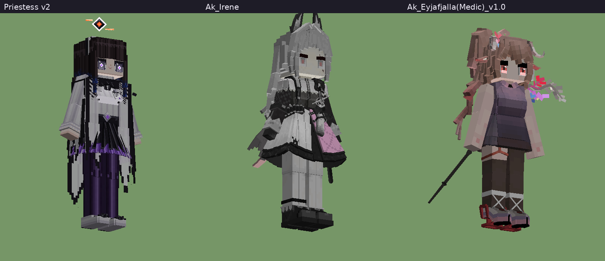
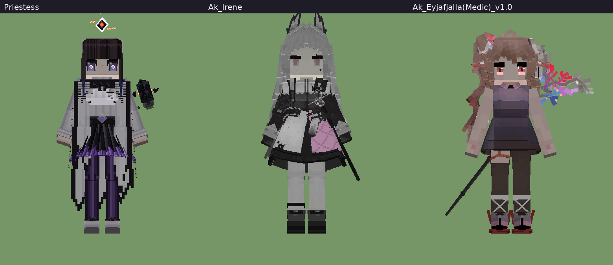
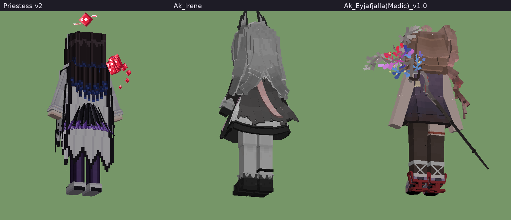
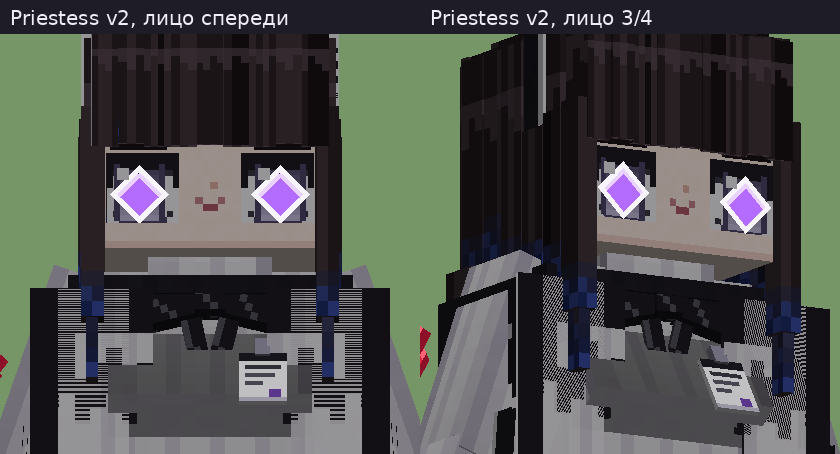
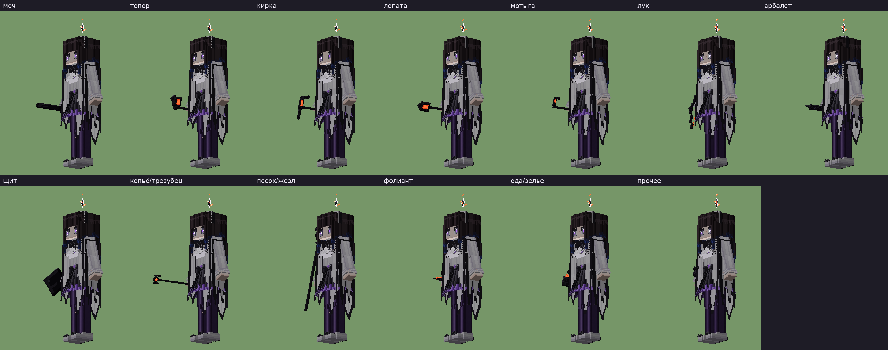
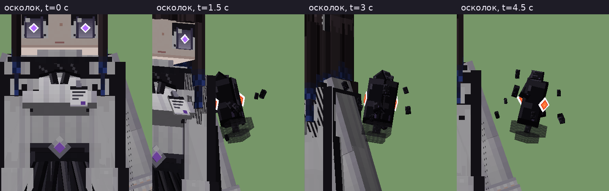

Превью состояний (свой рендер, не скриншот из игры — клиент YSM в облаке не запускается; `mods-src/ysm-priestess/previews.py`):
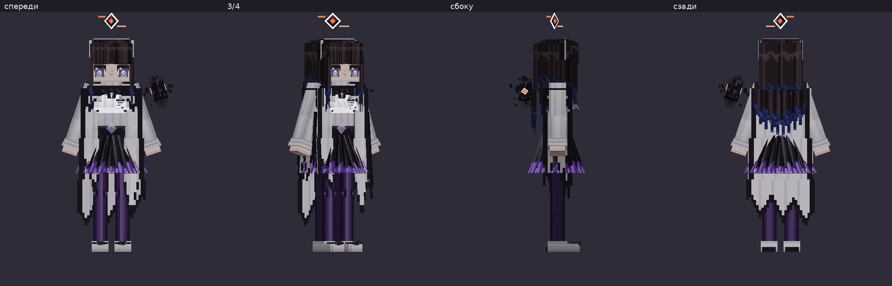
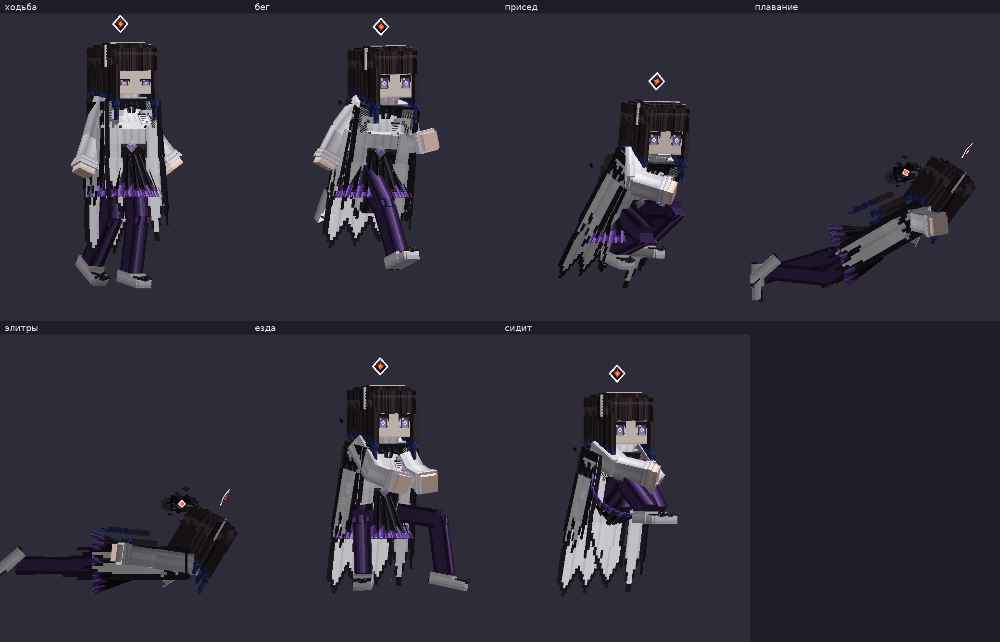
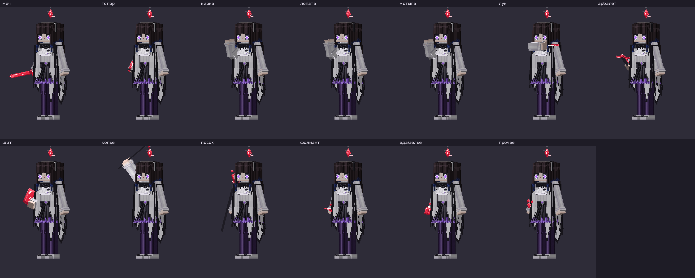
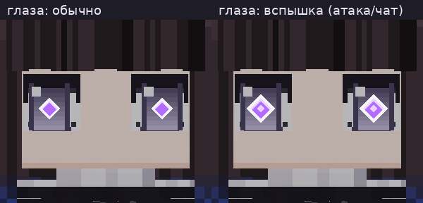
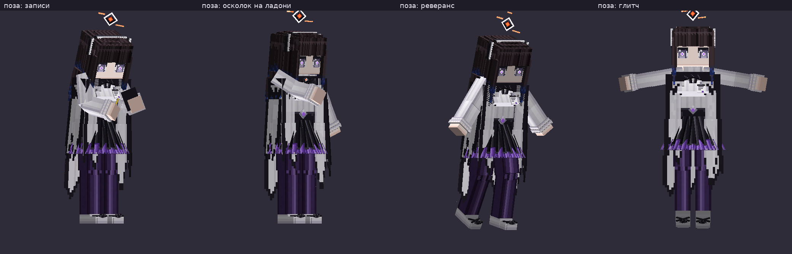

Механики:
- **Осколок Originium** всегда парит рядом (орбита вокруг игрока, покачивание, вращение), пока руки пусты.
- **Осколок принимает форму предмета** в руке (обе руки): меч, топор, кирка, лопата, мотыга, лук (тетива отходит при натяжении),
  арбалет, щит, копьё/трезубец, посох-жезл, фолиант (книга заклинаний), еда/зелье, «прочее» (гроздь кристаллов).
  Ванильный предмет при этом не рисуется (локатор руки масштаб 0) — **сам предмет работает как обычно**: скрывается только
  отрисовка, удар/выстрел/каст/еда идут по обычной механике игры. Первое лицо — обычный предмет (руки свитера).
  Категории — теги `mm:ysm_form/<форма>` (`pack/kubejs/server_scripts/ysm_priestess_forms.js`: ванильные и forge-теги
  + посохи/жезлы/палочки Iron's Spells, Cataclysm Spellbooks, Wizardry, Mana and Artifice, Ars Nouveau, Botania и др. по имени,
  книги заклинаний, всё съедобное и зелья). Без скрипта (чужой сервер) модель узнаёт оружие и инструменты по ванильным тегам.
- **Глаза-ромбы** (`ysmGlow…` — светятся в темноте и с шейдерами) вспыхивают — крупнее, белая обводка, яркая сердцевина —
  при атаке, ломании блока (`ysm.swinging`), использовании предмета (`q.is_using_item`), сообщении в чат (этап 3), с плавным затуханием.
- **Колесо → «Настройки»**: «Глаза светятся всегда», «Обычные предметы» (показывать ванильный предмет вместо формы осколка),
  «Нимб», «Осколок рядом». Настройки запоминаются (`v.roaming.*`).
- **Позы колеса**: «записи» (планшет с жёлтым стикером и карандаш), «осколок на ладони», «реверанс», «глитч»,
  плюс подменю «Ещё позы (default)» — 8 поз встроенной модели (танцы, жесты).
- **Плащ, волосы, ремешки** — «физика» по скорости, вертикали и повороту (как волосы default).

Проверка загрузки на сервере: `/ysm export priestess` в консоли (появляется `config/yes_steve_model/export/priestess.ysm`); проверено 2026-10-18 со всей сборкой.

Сборка: `python3 mods-src/ysm-priestess/build.py` (качает jar YSM по ссылке из `pack/mods/yes-steve-model.pw.toml` в
`mods-src/ysm-priestess/build/`, берёт оттуда скелет/анимации default и пишет модель в `pack/config/.../priestess/`), затем
`packwiz refresh`. Превью без игры: `mods-src/ysm-priestess/ysmrender.py` (свой рендер Bedrock-геометрии с анимациями
и molang; соглашения координат сверены на модели default).

## Отзывы владельца по Priestess
| Дата | Отзыв (дословно, через Координатора) | Что сделано |
|---|---|---|
| 2026-10-18 | «Это выглядит очень плохо в сравнение с Shu» (по скриншотам из игры: плоско, волосы монолитом, тёмное лицо без ромбов, плащ как серая безрукавка, колготки как штаны, аксессуары не видны, осколка не видно) | v2: разбор открытых моделей, текстура 256, пряди, юбка-складки, плащ сегментами, крупные аксессуары; превью — при игровом освещении |
| 2026-10-18 | «Самое важное — лицо с ромбами и осколок» | приоритет работ: лицо и осколок/формы первыми |
| 2026-10-18 | «По Priestess плохо, очень большие ромбы, на весь глаз, originium должен выглядеть примерно как на вложенной картинке… очень глупая улыбка» | v3: маленький ромб-зрачок в серо-фиолетовой радужке; осколок по референсу — чёрный угловатый кристалл, светится только маленькое ядро (белый ромб-контур + оранжево-красное свечение), рой чёрных обломков; формы из тёмных граней с ядром |
| 2026-10-18 | «Первая картинка плохо, вторая хорошо, также улыбка глупая, если не получится исправить, просто убери» (первая — устаревший `cmp_face.png` с крупными ромбами: его перезаписывал скрипт сравнения; вторая — `04_eyes.png`) | глаза оставлены как на `04_eyes`; улыбка убрана; `compare.py` больше не перезаписывает лист лица; ссылки на превью — закреплённые на коммит |

| 2026-10-18 | «Вот тут рот сделан как небольшой плоский элемент, выглядит не плохо» (скрин другой модели YSM) | рот — отдельная плоская деталь (кость `Mouth`): короткая нейтральная линия 0,84×0,16, чуть темнее кожи, без изгиба |

| 2026-10-18 | «Устраивает всё, кроме лица, как будто глаза посажены низко… сделай по высоте глаза также [как у Irene], убери всё с лица кроме глаз и волосы соответственно тоже подними и сделай чуть объемнее» | тело, осколок, формы — одобрены, не менялись. v4 лица: глаза подняты на +0,7 (низ глаза 1,55 над подбородком, как у Irene — 1,575); с лица убраны рот, румянец, брови, нос; чёлка и «шапка» подняты на 0,6, «шапка» шире (8,2), пряди толще (0,32–0,4) |

В сборку (новый PR) — только после «ок» владельца.

## Глаза при сообщении в чат (этап 3)
`pack/kubejs/server_scripts/ysm_chat_glow.js`: на сообщение игрока сервер выполняет
`/ysm molang execute <игрок> v.chat_glow=1`, через 2,5 с — `v.chat_glow=0` (новое сообщение продлевает). Модель гасит
свечение плавно. Команда YSM работает в сетевой игре и рассылает выполнение клиентам; на других моделях переменная
ни на что не влияет. Видят ли вспышку другие игроки, в облаке проверить нельзя (клиент YSM под ВМ не работает) — пункт чек-листа ниже; если не видно — запасной вариант через клиентский мод mm-perf (согласие владельца есть).

## Что проверить в игре (на ПК, вдвоём)
- [ ] Меню моделей: видны пакеты Arknights / Endfield / PGR и Priestess; модель выбирается, друг её видит.
- [ ] Priestess: осколок кружит рядом; меч/кирка/лук/посох Iron's/палочка Wizardry/книга Ars в руке → форма осколка, ванильного предмета не видно;
      лук стреляет, кирка копает, посох кастует; в первом лице — обычный предмет.
- [ ] Удар/копание/еда → глаза вспыхивают и гаснут; колесо → «Настройки» → «Глаза светятся всегда».
- [ ] Написать в чат → глаза вспыхивают на ~2,5 с, и это видит второй игрок.
- [ ] Позы колеса, «Ещё позы (default)»; плащ не протыкается ногами при беге (если протыкается — сообщить).
- [ ] Шейдеры (Oculus): глаза, нимб, осколок светятся.
